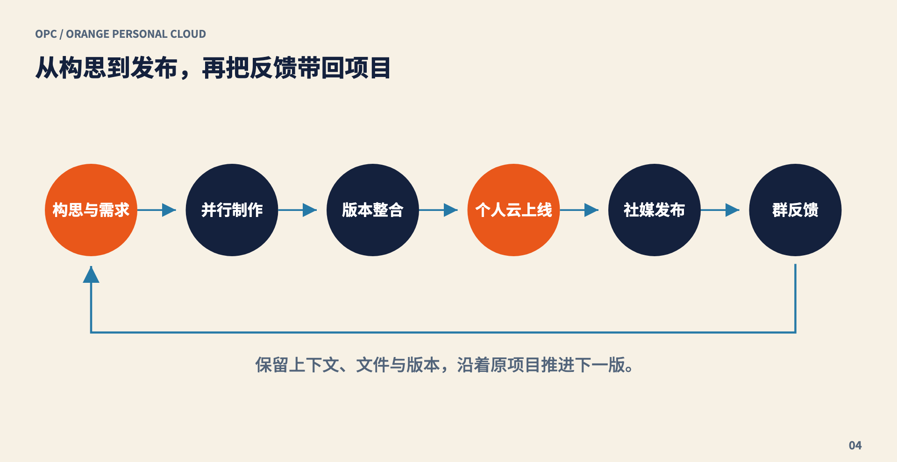

# Orange Personal Cloud 中文文库

本中文文库介绍 OPC 的产品工作方式与经济机制设计。

一个想法进入个人云，需求、资料、设计、代码和版本就有了共同的工作位置。OPC 让多个 智能体 带着同一项目的上下文推进任务，把更改保存在工作树里，整合后默认发布到个人云。用户确认新版本，机组继续准备 版本发布 文案和海报；发布后的业务讨论和反馈，又接回下一轮工作。

SIGN 承接 AI 服务调用与生态协作的底层结算。OPC 提供持续工作的产品环境，创作者把应用、智能体 和模板带进市场，需求发布者也可以在市场上寻找能完成交付的供给。本文件库把这些工作方式与经济机制展开说明。

## 选择适合你的入口

| 你想了解什么 | 从这里开始 |
| --- | --- |
| 先把整个项目读明白 | [一文读懂 OPC](overview.md) |
| 深入了解产品、协作和个人云 | [个人云的工作空间](whitepaper/02-personal-cloud.md) |
| 了解 SIGN 在服务中的角色 | [SIGN 底层结算](whitepaper/08-sign-settlement.md) |
| 查看 OPC 经济模型 | [发行与分配](whitepaper/09-token-distribution.md) |
| 按具体问题查答案 | [百问百答](faq/README.md) |
| 核对当前机制运行的细则 | [机制运行与结算细则](whitepaper/17-open-parameters.md) |

产品工作流程与收益型入金分别按各自的规则说明。涉及金额、比例、OPC 数量和 USDT 计价的段落，均写出计算基数；产品场景以活动报名与会员管理应用程序 为例。

## 官方入口

- [GitHub](https://github.com/OrangePersonalCloud)
- [OPC 资料库](https://library.orangepilotcrew.com)
- [Telegram 社群](https://t.me/OrangePersonalCloud)

版本：2026 年 11 月中文文库。
