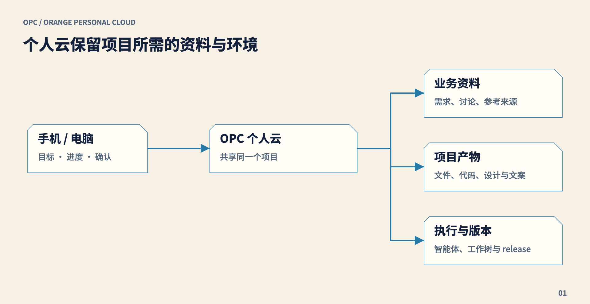

# 项目定位与个人云

### Q001 OPC 是什么？

OPC 是 Orange Personal Cloud，中文称为个人云。它把项目资料、智能体（agent）执行、文件产物、版本与发布放进同一个工作空间，让一个想法能够沿着需求、制作、验收到上线经营持续推进。用户负责方向和关键确认，机组带着共同的项目背景执行工作。应用上线以后，反馈与新需求继续回到原项目，为下一版提供依据。

*图：项目资料、执行与版本、进度与发布围绕同一个个人云组织。场景示意。*

### Q002 个人云为谁解决什么问题？

个人云面向需要把想法做成产品并持续经营的人，包括独立创业者、业务负责人和创作者。实际工作常常同时涉及需求、界面、代码、内容与用户沟通，资料散落会增加交接成本。OPC 将这些工作围绕项目组织起来，让你查看当前进度、审阅已有产物，再决定下一步，而不必在每轮修改时重新解释整个业务。

### Q003 “把想法做成产品”具体包含哪些工作？

它包含明确服务对象与需求、准备设计和实现方案、并发制作、整合更改、检查版本以及发布到个人云。发布后，智能体还能准备版本更新说明、文案和海报，经用户确认后用于社交传播。以活动报名与会员管理应用程序为例，报名页、会员模块、测试结果和上线说明都围绕同一项目推进，构成可以继续修改的交付。

### Q004 个人云里会保留什么？

个人云保留项目需求与业务背景、项目文件与产物、智能体任务、工作树与更改记录，以及任务进展、应用版本和发布信息。这些内容共同说明项目为何这样做、目前做到了哪里、下一次从哪里继续。例如会员入口的位置发生调整时，已有界面、相关代码和验收要求仍属于这个项目，可供后续整合时一起检查。

### Q005 OPC 与一次问答式的 AI 使用方式有什么差别？

OPC 把工作组织为持续推进的项目。你提出目标之后，后续设计、开发、测试和传播沿用项目资料，产物与版本也留在个人云中。一次回答可以帮助形成想法，持续项目则需要把修改落实到文件、检查结果和可发布版本。OPC 的产品重点正是让这些交接接得上，使下一轮工作能够继承前一轮已经完成的内容。

### Q006 OPC 是否只适合写内容？

内容创作是 OPC 的使用场景之一，当前产品范围还包括应用开发、并发智能体协作、独立工作树、版本整合、个人云发布和市场交付。活动报名与会员管理应用程序可以从功能需求推进到应用上线，再生成本轮更新的社媒素材。品牌内容也能带着业务群背景开展，选题、文案、海报及反馈留在同一个项目里持续使用。

### Q007 为什么强调从上线继续到经营？

一次上线会带来新的用户回应，也会暴露下一轮需要处理的需求。OPC 将发布后的反馈接回原项目，使界面调整、功能更改、测试和新版本发布能沿着已有版本继续。活动应用程序上线后，会员提出更快找到专属入口的需求，就可以关联到入口设计和报名功能，让每次经营中的发现都有机会成为下一次具体交付。

### Q008 在 OPC 中，用户掌握哪些关键决定？

用户掌握目标、需求范围、验收和发布等关键判断。你说明产品做给谁用、解决什么问题，并查看界面、代码及测试结果，提出修改后再确认版本。智能体在共享项目中执行任务，工作台将产物、进度和版本放回你的判断过程。目标可以随着业务调整，判断也能以当前交付为依据，不需要把全部方向一次性定死。

### Q009 OPC 的“机组”指什么？

“机组”是对协作智能体的产品化表达。不同智能体根据项目需要承担研究、设计、开发、测试或发布材料准备等工作，能够独立推进的部分同时展开，并通过具体产物交接。用户负责掌舵，机组围绕共同的项目背景执行；分工随需求与任务依赖调整，完成的界面、代码和检查结果再回到同一版本，构成可以审阅与发布的成果。

### Q010 OPI 是谁，在产品里承担什么作用？

OPI 是个人云里的橙色 AI 小机长，也是 OPC 的品牌形象。橙色头盔、向上箭头和身边的小无人机，把机组协作转化为更容易认识的角色。OPI 出现在产品引导、任务进度、产物审阅和发布等场景，也参与社群内容与品牌传播。理解具体能力时，仍应查看相应的任务、文件、版本与服务说明。

### Q011 手机和电脑如何衔接同一个项目？

手机提供轻量入口，适合说清目标、看进度和审阅修改；电脑可以继续处理同一项工作。执行环境、项目文件和版本记录保留在个人云中，项目不依附于某一台终端。你在手机上提出会员入口调整，之后换到电脑检查界面与版本时，可以沿用原来的需求和产物，让工作围绕同一项目保持连续。

### Q012 从想法到经营，OPC 怎样把完整流程接起来？

OPC 已经连通需求确认、并行制作、工作树整合、个人云上线及后续传播和反馈的完整工作路径。各环节围绕同一项目衔接，应用上线后，新的业务回应能够继续成为任务。应用、创作者与业务连接沿这条路径持续扩展，为个人云带来更丰富的服务供给。产品交付围绕实际项目展开，经济机制则通过各自的结算记录呈现资产与奖励安排。
