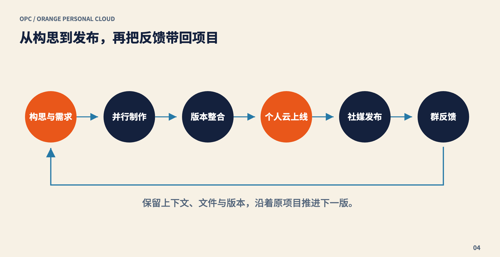

# 工作台、目标与任务

### Q013 第一次创建项目时，怎样把目标说清楚？

可以从服务对象、要解决的问题、当前交付范围和验收要求开始描述。以活动报名与会员管理应用程序为例，先说清谁组织活动、谁报名、会员如何使用，再列明本轮要完成的报名页面、会员管理和签到名单导出需求。目标越具体，机组越容易形成可以制作和检查的任务，后续审阅也有共同的判断依据。

### Q014 一个需求怎样成为可执行的任务？

需求进入项目后，需要明确它影响的流程、要形成的产物以及完成的判断条件。例如“增加会员入口”可以进一步说明入口所在页面、跳转去向和报名流程如何衔接，再交给相关智能体处理界面与功能。任务围绕共同项目背景分派，产物回到整合环节时，就能对照原始要求检查，避免只完成局部动作而遗漏业务目标。

### Q015 工作台中的背景是什么意思？

项目背景是让智能体理解这项工作所需的背景，包括需求、业务资料、已有产物和验收要求。它解释当前任务与整个项目的关系。例如调整会员入口时，智能体需要知道活动应用程序的报名路径和现有会员模块，才能把改动放在合适的位置。共享背景让不同任务使用共同依据，后续修改也能接着原项目继续。

### Q016 我应该给智能体哪些资料？

应优先提供与本轮目标直接相关的业务说明、品牌资料、现有界面或文件、功能要求及验收条件。活动应用程序项目可以交代报名规则、会员入口需求和当前版本中需要保留的行为。资料的作用是帮助机组理解工作对象与边界，减少对业务含义的猜测。若需求来自获授权的业务群，对话中的背景也能成为项目输入。

### Q017 怎样为活动报名与会员管理应用程序确定首轮范围？

先围绕一条能够检查的用户流程确定范围，例如用户找到活动、完成报名，再由组织者查看会员与签到名单。把本轮必须形成的页面、功能与交付结果写清楚，机组便能据此安排工作。会员专属入口等后续调整可以进入下一轮需求。这样每次确认都有明确对象，也能让新增想法与当前正在整合的版本保持关系。

### Q018 验收要求为什么要在制作前讲清？

验收要求让需求、执行和最终检查使用同一把尺子。例如会员入口改动除了需要出现按钮，还要确认入口位置、跳转去向以及与报名流程的衔接。先说明这些要求，设计和开发就能围绕同一目标工作，整合时也知道要检查什么。用户仍然可以提出新判断，但应将它落实为具体修改，便于机组继续处理。

### Q019 工作台如何帮助我了解项目进度？

OPC 把任务进展与具体产物、版本关联起来。查看进度时，可以结合需求说明、界面方案、代码更改及测试结果，判断项目正在推进哪一部分、还需要什么交接。例如报名页已完成修改，会员模块仍在处理，后续就需要等相关更改进入同一版本检查。理解进度的重点，是看交付物是否足以支持下一步工作。

### Q020 一个项目可以同时包含应用和传播素材吗？

可以。应用版本与对外传播都属于同一项目的工作。活动应用程序完成本轮更改后，机组可以根据实际更新准备版本更新说明、文案与海报，经用户确认后发布。因为这些材料沿用项目背景，传播内容能够围绕已经完成的功能展开，后续收到的回应也可以回到项目中，形成下一轮产品或内容任务。

### Q021 需求中途变化时应该怎样继续？

把变化说成具体的新要求，并说明它影响当前交付的哪一部分。例如从普通报名入口调整为突出会员入口，就需要重新确认界面位置、会员识别与报名衔接的预期。OPC 保留已有背景、产物和版本，机组可以沿着原项目处理更改。用户在整合和验收时，再对照更新后的目标判断本轮是否可以发布。

### Q022 收到初稿后，怎样提出有效修改？

修改意见最好指向具体对象和预期效果，例如“报名页首屏增加会员入口，并说明点击后去哪里”，比笼统要求“更高级”更便于执行。审阅时可以结合界面、功能和测试结果，指出需要保留或调整的部分。机组根据反馈继续更改，并将产物回到项目版本中，让下一次审阅能够判断这项意见是否已经落实。

### Q023 研究、设计和开发怎样交接？

交接依靠可继续使用的产物。研究与设计可以形成需求说明、界面方案和参考资料，开发据此修改页面或功能，测试再结合需求检查更改。共同背景帮助大家理解业务目的，具体产物则说明当前已经做出了什么。每一环节应把下一环节需要的内容留在项目里，减少只传达口头结论而无法继续执行的情况。

### Q024 开发完成就等于本轮任务结束了吗？

本轮是否结束取决于约定的交付范围。对于应用发布，代码更改还需要与相关界面、功能和测试结果一起整合，再由用户审阅确认。若任务还包括版本发布文案与海报，这些材料也属于待交付内容。把结束条件写在需求与验收中，可以让机组围绕完整结果推进，也方便用户判断现在是否具备发布条件。

### Q025 如何让测试围绕真实业务展开？

先把用户流程和本轮变化说清楚，再对照检查。会员入口调整可以围绕入口是否容易找到、跳转是否符合需求、报名与会员功能能否衔接来审阅。OPC 将测试结果与设计、开发产物放回同一项目，方便用户综合判断。审阅时把检查结论与相应更改一起看，才能知道当前版本对哪些要求已经给出了回应，还有哪些内容需要继续修改。

### Q026 个人云中的项目为什么可以反复迭代？

每轮交付都会留下继续工作所需的需求、文件、更改记录与版本，新的反馈可以沿着原项目转化为任务。活动应用程序第一轮上线后，下一轮增加会员入口，就能利用已有报名与会员模块继续处理。项目的连续性来自这些可继承的资料和环境，让每次发布既形成当前成果，也为后续调整保存工作基础。

*图：需求、制作、发布与反馈连续连接，形成下一轮工作的基础。场景示意。*

### Q027 如何在需求中区分必须完成和可以后续处理的内容？

可以明确本轮发布需要达到的效果，并把新增想法标为后续目标。例如首轮要求活动报名与会员管理流程可供验收，新发现的专属入口优化再安排到下一轮。这是一种组织需求的方法，能够帮助用户决定当前版本何时可以确认。机组则围绕本轮范围交付，避免新意见不断加入时让既有工作失去明确终点。

### Q028 用户需要一直盯着智能体工作吗？

用户的主要投入集中在表达目标、查看进度、审阅产物和确认发布。执行环境与任务留在个人云，手机和电脑都可以作为项目入口。为了让判断有效，仍应在需求或交付需要确认时给出清楚意见。OPC 将持续执行与关键决策接在一起，让你通过项目中的实际产物掌握工作，而无需把每次执行都当作新的独立委托。
