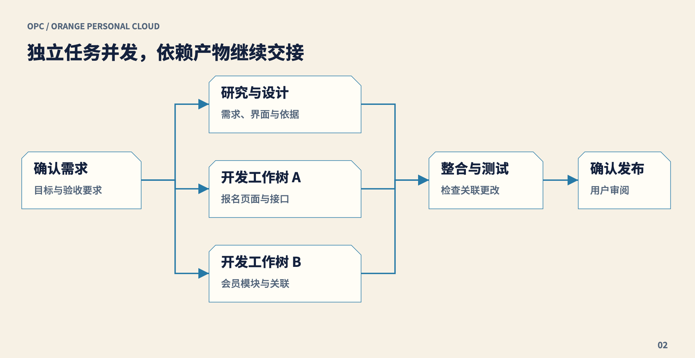
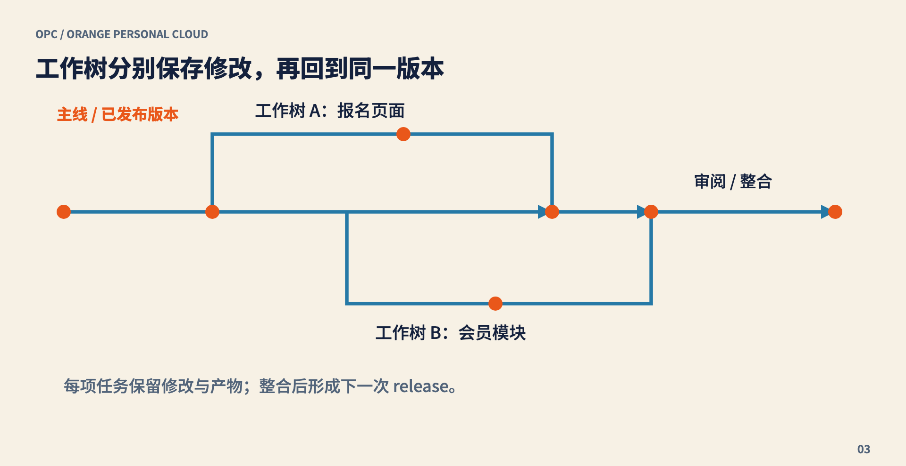

# 多智能体、并发与版本

### Q029 多个智能体如何同时推进一个项目？

多个智能体共享项目的需求、已有资料和验收要求，分别承担可以独立推进的任务，并在独立工作树中保存修改。活动应用程序的报名页面与会员功能可以分开制作，之后进入同一版本整合和测试。并发围绕任务之间的依赖安排：能够分开的工作同时展开，需要前置结果的环节等待相应产物，再继续推进。

*图：箭头表示任务依赖，可分开的分支同时推进，之后进入整合与发布。场景示意。*

### Q030 并发是否意味着所有工作都同时开始？

并发需要结合任务依赖。需求与验收要求为后续工作提供共同依据，能够独立制作的界面或功能可以同时推进；整合则需要对应更改准备完成，发布还需要用户确认。将这些关系讲清楚，才能判断哪些工作适合并行、哪些需要交接。OPC 的机组安排围绕实际任务展开，不要求每个环节都在同一时间启动。

### Q031 为什么多个智能体需要共享背景？

共享背景让不同智能体对产品目的、需求范围和验收条件保持共同理解。例如报名页面与会员模块由不同任务推进，两边仍需使用相同的活动与会员流程，才能在整合后形成连贯体验。如果只看各自局部，容易出现界面与功能的理解差异。项目资料提供共同依据，独立产物再把各自完成的更改带回整合环节。

### Q032 工作树是什么，为什么要使用独立工作树？

工作树为不同任务保存各自的项目文件与更改，让报名页面、会员功能等修改可以分别推进。它们仍属于同一项目，共享必要背景，完成后再进行审阅与整合。独立保存更改有助于看清每项任务改了什么，也让并发工作在汇入应用版本前有明确的检查对象。最终发布的是经过整合与确认的项目版本。

*图：不同任务分别保存更改，再整合为同一项目中的发布版本。场景示意。*

### Q033 共享背景与独立工作树会冲突吗？

两者承担不同作用，能够配合使用。共享背景回答“为什么做、要达到什么效果”，独立工作树保存“这项任务具体改了哪些文件”。例如报名页和会员模块可以遵循同一需求，分别保留更改，再在整合时检查衔接。机组因此既能理解共同目标，也能让各项修改有清楚的来源，便于用户审阅本轮交付。

### Q034 报名页面和会员功能为什么适合拆开推进？

它们可以形成相对明确的任务与产物：报名页面负责入口、信息呈现与相关流程，会员功能处理对应的会员需求。先约定两者如何衔接，再由不同任务分别修改，能够使独立部分同时向前。拆分之后仍需共同整合，检查入口跳转和功能关联。是否拆分、怎样拆分，应以本轮需求和依赖关系为依据。

### Q035 任务依赖图应当怎样阅读？

依赖图中的节点表示工作环节，箭头表示后续任务需要哪些前置结果。同一阶段分开的支路代表可以同时推进的工作，例如报名页面与会员功能；汇合处表示需要整合相关产物，再检查和发布。阅读时先找共同需求，再看各分支产物，最后看它们如何进入版本。这样能够理解并发安排，也能找到尚未完成的交接。

### Q036 机组如何根据项目安排不同角色？

机组围绕实际目标安排研究、设计、开发、测试和传播等工作，角色与任务数量可以灵活调整。应用项目需要界面设计、不同功能开发与整合检查，品牌项目则可能更侧重选题、文案与海报。先把任务、产物和交接关系说清楚，再让能够独立推进的工作并发执行。每个角色的成果进入共享项目，共同服务于用户确定的交付目标。

### Q037 多个任务修改有关联的内容时，怎样判断结果？

应在整合阶段结合共同需求检查相关更改。报名页新增会员入口，既影响界面，也关联会员功能，局部任务各自完成后仍要看整体流程是否符合验收要求。独立工作树保留修改来源，测试与审阅提供判断依据。发生需要取舍的地方，由用户给出明确意见，再让机组继续处理，结合各项实际结果判断更改如何进入本轮交付，再决定发布。

### Q038 “整合版本”具体在整合什么？

整合会把各任务形成的界面、功能代码、更改记录和检查结果汇入同一应用版本。它关注的不只是文件放到一起，还包括不同功能是否按需求衔接、修改是否覆盖验收条件。活动应用程序的报名与会员更改要在整体流程中一起检查。完成审阅后，用户再确认本轮版本发布，使发布内容对应一份清楚的交付结果。

### Q039 工作树完成后，用户应重点审阅哪些内容？

可以先对照该任务的目标，看产物是否回应原始需求，再看它与其他任务的关联。例如会员入口工作需要检查位置和跳转，也要结合报名流程检查衔接。随后结合整合版本与测试结果，判断改动是否适合进入本轮发布。工作树保留更改记录，为审阅提供具体对象，用户的反馈应尽量指向需要保留、调整或补齐的内容。

### Q040 版本记录如何帮助后续修改？

版本记录保留本轮更改与发布的关系，让后续工作知道当前成果从哪里来。活动应用程序上线后再次调整会员入口时，可以沿着已有项目资料和更改记录理解前一轮决定，再提出新的需求。机组以当前版本为基础继续处理，用户也可以结合前后产物说明修改意图，使下一次审阅围绕实际变化展开，并把新的决定留在同一项目中。

### Q041 为什么测试结果要和版本放在一起看？

测试结果说明某一轮更改经过了哪些检查，版本则说明这些检查对应的应用内容。把两者结合起来，用户才能判断当前准备发布的功能是否符合需求。例如报名页与会员模块分别修改后，要看整合版本中的关联流程，而不只看某个局部任务的结论。这样的审阅方式让确认建立在相互对应的产物与结果之上。

### Q042 并发智能体的工作最终由谁决定是否接受？

用户负责需求方向、验收和发布等关键决定。智能体可以并发准备方案、实现功能并形成检查结果，工作台将这些产物汇回同一项目，供用户审阅。对于会员入口的位置或本轮功能取舍，用户可以给出修改意见，再确认整合后的版本。并发改变了执行组织方式，最终交付仍需回到明确的需求与用户判断。

### Q043 一个任务延后，会怎样影响其他工作？

影响范围取决于依赖关系。如果会员模块尚未准备完成，独立的报名界面工作可以继续，但关联两者的整合检查需要等待必要产物。清楚的需求和交接关系帮助用户理解哪些进展可以独立成立、哪些仍影响本轮发布。处理这类情况时，应先找到尚缺的交付物，再判断能否调整本轮范围，让后续安排与实际完成状态保持一致。

### Q044 每次并发结束后，项目应留下什么？

应留下可以接着工作的需求与验收依据、各任务的实际产物、更改记录、整合版本和相应检查结果。如果本轮包含发布，还需要对应的版本更新说明与传播素材。这些内容共同说明完成了什么以及下一轮从哪里继续。OPC 将它们保留在个人云中，让一次并发协作形成可审阅的交付，也为后续迭代积累项目基础。
