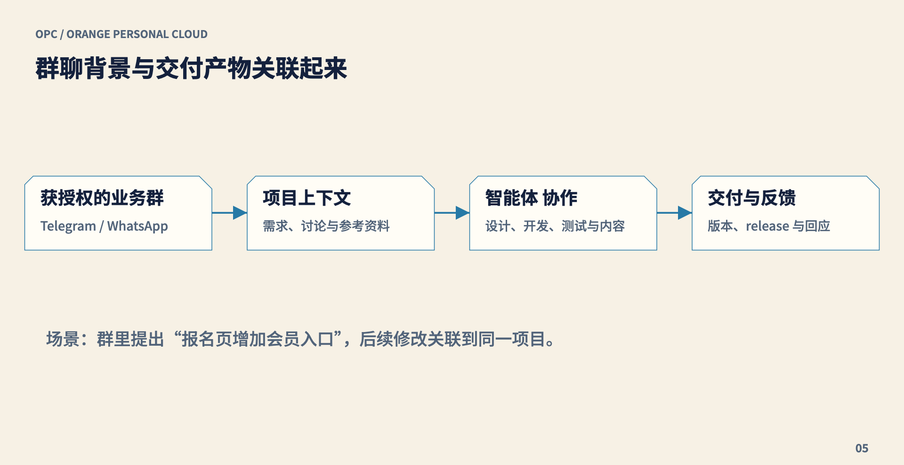

# 云端发布、业务群与社媒

### Q045 “默认发布到个人云”是什么意思？

应用经过整合与用户确认后，默认发布到 OPC 个人云。版本、运行环境和项目资料在这里继续关联，后续修改沿着同一项目进行。对于活动报名与会员管理应用程序，一轮发布形成当前可使用的成果，新的会员入口需求再进入下一版。用户确认每次版本发布，机组继续准备更新说明和传播材料，让上线后的业务沟通与产品迭代接续展开。

### Q046 应用上线后，项目为什么还要保留原来的执行环境？

后续功能更改需要延续现有应用的资料、文件和版本关系。OPC 将执行环境与项目留在个人云中，用户换用手机或电脑时仍能接着同一项工作。活动应用程序收到会员入口反馈后，可以沿用原有报名与会员背景继续修改，形成新的整合版本。新任务由此能够从已发布应用出发，结合原来的需求与产物推进，保持发布与迭代之间的连续关系。

### Q047 OPC 如何把 Telegram、WhatsApp业务群接入项目？

OPC 工作台通过 API 读取已经获得授权的业务对话，把其中的需求与反馈带进项目背景，再交给正在工作的智能体处理。业务群中的“报名页增加会员入口”可以由此关联到需求、界面与功能修改。用户结合原项目确认改动目标，机组沿着现有产物继续执行，使聊天里的业务背景成为可以落实、审阅并进入版本的工作。

*图：已经授权的业务反馈进入项目，并关联需求、执行和交付产物。场景示意。*

### Q048 群里的一条意见会怎样成为产品改动？

群意见先进入项目背景，再结合已有产品确认它影响的需求与验收要求。例如“会员难找到报名入口”需要落实为入口位置、跳转方向和报名衔接等具体目标。相关智能体随后准备界面与功能更改，在工作树中保存，再进行整合检查。这样群反馈能够与交付产物相连，发布后也可以继续围绕同一需求回收回应。

### Q049 为什么读取业务群需要授权？

业务群包含项目讨论、客户要求与经营背景，授权决定哪些业务对话可以进入工作台。OPC 通过 API 读取已授权的内容，让智能体带着相关背景理解需求并推进任务。用户围绕当前项目连接业务来源，再审阅由此形成的需求、界面与功能产物。读取与发布分别对应项目输入和对外表达，社交内容仍经过用户确认后发布，让业务信息服务于明确工作。

### Q050 群聊业务背景与直接粘贴一句需求有什么关系？

直接提出需求可以说明本轮要做什么，群聊业务背景则能补充需求产生的背景与后续回应。会员入口问题可能来自用户的使用讨论，结合这些信息更容易理解改动目的。OPC 将已授权的业务对话带进项目，同时保留已有需求和产物，使机组围绕业务背景继续工作。最终仍要把讨论转成可执行、可验收的具体要求。

### Q051 连接业务群是否等于群消息会自动对外发布？

业务群读取用于获取已授权的需求与反馈，社媒发布则有用户确认这一环节。机组根据项目进展准备版本发布文案与海报，经过确认后再发布到相应平台。两者分别连接项目的输入与对外表达，群讨论应先转化为合适的任务或内容。审阅时需要核对发布材料是否准确反映当前版本，以及是否适合面向目标受众表达。

### Q052 OPC 可以把新版本发布到哪些社交平台？

OPC 连接 X/Twitter、Facebook、小红书等社交平台的发布连接。机组可以围绕新版本发布准备文案与海报，经用户确认后发布，让产品更新衔接用户沟通。活动应用程序的会员入口更新可以先形成清楚的更改说明，再整理成适合目标受众的对外表达。项目中的发布材料与后续反馈继续保留，供下一轮产品和内容工作使用。

### Q053 为什么社媒内容需要与应用版本关联？

社媒内容描述的是一轮实际进展，与版本关联能让对外表达有明确依据。例如活动应用程序新增了会员入口，版本更新说明和海报就应围绕这项改动的使用价值展开。用户确认内容后发布，收到的回应又可以关联到该版本继续处理。这样产品变化、传播材料与后续需求之间有清楚关系，便于持续经营同一个项目。

### Q054 确认社媒发布时应该看什么？

先核对本轮更新是否真实出现在准备发布的版本中，再检查文案和海报是否准确表达功能、受众与使用价值。活动应用程序的会员入口更新，应说清入口与报名流程的变化，让受众理解这次改动对使用有什么帮助。用户结合目标平台审阅内容并作出确认，机组再继续发布。把版本、素材和表达一起核对，可以使对外沟通与当前交付保持一致。

### Q055 发布后的反馈如何进入下一轮？

已授权业务对话中的用户回应可以进入项目背景，结合当前版本转成新的需求，再由机组处理。比如会员入口上线后，用户希望位置更醒目，这条回应可以关联到原界面与功能，推进下一轮更改。OPC 保留资料、产物和版本，让反馈沿着原项目继续。反馈是否需要执行以及本轮如何验收，仍由用户结合业务目标判断。

### Q056 品牌内容项目也能使用同样的连接方式吗？

可以。品牌内容工作可以结合业务群讨论、既有品牌资料和本周产品进展，准备选题、文案与海报，再由用户确认后发布到社交媒体。内容素材和后续反馈都留在同一个项目中，方便下一轮沿用背景。它与应用项目共享持续工作的方式，区别在于当前交付的对象是内容。相关模型、工具与智能体服务同样接入 SIGN 底层结算。
