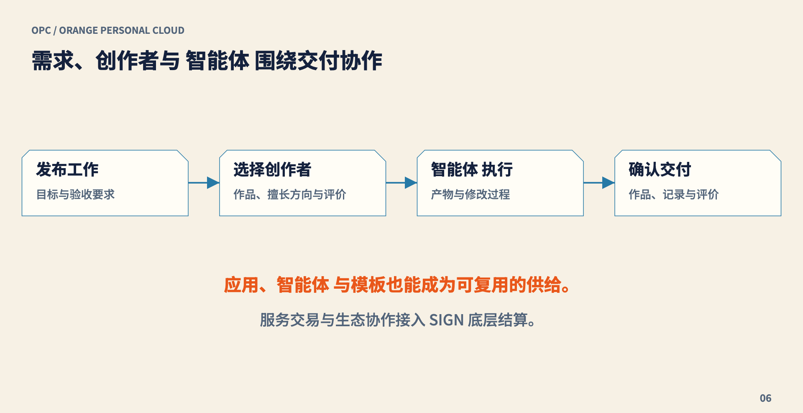

# 市场、创作者与生态协作

### Q057 OPC 应用市场提供什么？

OPC 应用市场连接需求发布者、创作者与可复用能力。用户可以发布工作，创作者接受委托并借助智能体完成交付；成熟的应用、智能体和模板也能上架，供其他人使用。作品、进度与评价在市场中持续积累，帮助后来者了解供给方。服务交易与交付协作通过 SIGN 接入平台底层结算，与个人云中的项目工作相连。

*图：需求发布者、创作者与智能体围绕目标、产物和验收协作。场景示意。*

### Q058 发布一项工作时需要说明哪些内容？

应说明交付目标、业务背景、当前已有资料以及验收要求。委托活动报名与会员管理应用程序的工作，可以写清需要完成的报名流程、会员功能和本轮产物，使创作者据此理解工作范围。需求说明也应表达哪些内容是本轮重点，以及用户希望通过什么结果判断完成。这样选择创作者、推进执行和最终审阅都能围绕同一项具体工作展开。

### Q059 如何从市场里选择合适的创作者？

可以结合创作者展示的作品、评价和擅长方向，判断其是否适合当前任务，再围绕具体需求展开协作。活动应用程序项目需要关注相关应用交付经验和对报名、会员流程的理解，内容项目则更关注对应内容能力。作品与评价提供可参考的记录，最终仍需把本轮目标和验收说清楚，使选择转化为可以共同推进的实际工作。

### Q060 创作者接单后，智能体扮演什么角色？

创作者接受工作后，可以使用智能体推进研究、设计、开发或内容制作，并组织产物交付与修改。智能体的工作围绕委托需求展开，项目进度和产物为发布者审阅提供依据。创作者需要将需求解释清楚，把各项产物组织成能够验收的结果，并结合反馈继续处理修改。服务用量和相应市场交易通过 SIGN 进入平台底层结算流程。

### Q061 任务交付通常沿着什么顺序推进？

产品说明中的市场协作路径为发布需求、选择创作者、智能体执行、审阅产物与确认交付。每次交接都有具体对象：发布者交代目标，创作者接下工作，智能体形成产物，发布者对照验收要求审阅。若有修改，再围绕原任务继续推进。工作进度、实际作品与评价随协作积累，让当次交付有依据，也为之后寻找合适供给提供参考。

### Q062 应用、智能体和模板上架分别有什么价值？

应用把已经形成的产品交给更多人使用，智能体提供可承担工作的能力，模板让成熟的方法与结构更便于复用。它们共同把一次项目中的成果转化为市场供给，用户可以按自己的任务寻找合适内容。选择时应先看当前需求：希望使用成品、引入执行能力，还是借鉴已有结构，再判断具体供给与项目目标是否匹配，提高已有成果的复用价值。

### Q063 为什么市场要积累作品、进度与评价？

作品展示实际做过什么，进度帮助参与者了解工作如何推进，评价为后续选择提供交付参考。这些记录让需求发布者更容易判断创作者与当前任务是否匹配，也让创作者通过具体成果展示能力。查看时可以把记录与任务类型一起理解：应用开发关注功能交付，内容工作关注相应素材和表达。持续积累的实际工作，让合作选择有更具体的依据。

### Q064 个人云项目与市场委托有什么关系？

个人云承接项目的需求、产物、版本和持续迭代，市场则帮助项目找到创作者及可复用能力。用户可以围绕工作目标选择合适供给，创作者借助智能体完成任务，再由发布者审阅交付。两者围绕具体项目连接起来，让独立工作与外部协作能够服务于同一成果。相关模型、智能体与市场服务也由 SIGN 连接底层结算。

### Q065 创作者怎样把一次交付积累为后续机会？

把需求落实为可查看的产物，并在协作中留下清楚的进度和评价，可以帮助后续需求方了解你的能力。成熟的应用、智能体或模板还可以作为可复用供给进入市场，让经验有机会服务更多项目。创作者既能接具体工作，也能展示已有成果。围绕擅长方向持续交付，能够让作品与评价形成更清楚的能力说明，帮助合适的需求找到你。

### Q066 生态伙伴可以如何参与 OPC？

生态伙伴可以把业务工具与专业服务连接到个人云，围绕具体项目提供能力；创作者可以接受委托，发布应用、智能体或模板。参与重点是让用户的需求得到可以审阅的交付，让成熟供给在市场中被发现。专业能力进入项目后，可以与已有机组工作衔接，服务于共同的需求与验收目标。SIGN 则承接相关服务交易的底层结算。
