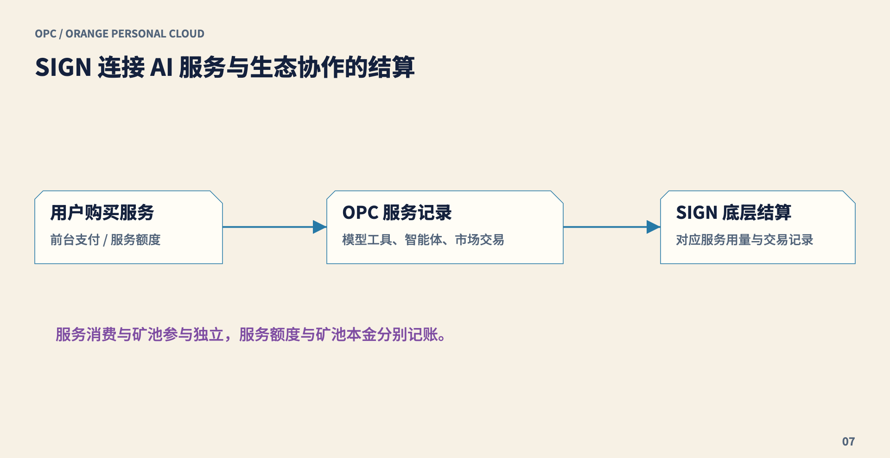

# SIGN、OPC 与服务结算

### Q067 SIGN 在 OPC 中承担什么角色？

SIGN 是连接 AI 服务与生态协作的底层结算代币。模型与工具调用、智能体执行、应用和模板使用以及创作者服务交易，都可以根据服务用量与交易记录接入这一结算基础。在收益型入金路径中，SIGN 还承担由 USDT 转入后继续分配的中间交换作用。理解 SIGN 时，需要同时看到产品服务结算和经济机制中的不同使用场景。

*图：前台购买方式与底层服务结算分工，模型、智能体和市场服务接入 SIGN。架构示意。*

### Q068 SIGN 与 OPC 代币有什么区别？

SIGN 用于 AI 底层服务结算，并在收益型入金中承担中间交换作用；OPC 是本模型发行与奖励发放的代币。静态奖励以 USDT 本位计算、以 OPC 支付，流动性使用 OPC 与 SIGN 配对。两种资产在流程中各有用途，用户应先看自己进行的是服务购买、市场协作还是收益型入金，再对应理解它们参与哪一段。

### Q069 前台可以用法币或额度购买，为什么底层还使用 SIGN？

前台购买方式面向用户的使用习惯，底层结算则连接模型、工具、智能体与市场服务供给。用户可以通过法币或额度等方式购买服务，平台根据相关服务用量和交易记录使用 SIGN 进行底层结算。用户因此可以围绕任务选择所需服务，供给方则通过共同结算路径参与协作，让个人云中的实际工作与服务之间的价值交换相连接。

### Q070 模型与工具调用为什么需要服务记录？

服务记录用于对应项目中实际发生的模型与工具使用，使结算有明确的服务对象与用量依据。活动应用程序的研究、代码制作或内容准备会涉及不同服务，记录将这些使用与项目工作关联，再进入 SIGN 底层结算。产物说明工作做出了什么，服务记录说明执行中使用了哪些供给；两类信息共同把项目交付与其所依赖的服务联系起来。

### Q071 并发智能体的执行怎样与 SIGN 关联？

并发任务会形成相应的服务使用与交付记录，例如报名页面开发、会员功能制作及发布材料准备。SIGN 承接这些 AI 服务的底层结算，让不同任务产生的服务用量有共同结算基础。用户在项目中查看需求、进度和产物，理解各项工作如何汇入同一版本；对应的服务记录则连接执行过程与结算，使并行协作仍围绕具体工作展开。

### Q072 SIGN 如何参与应用与任务市场？

市场中的应用、模板使用和创作者服务交易，属于 SIGN 承接的底层结算场景。用户发布工作，创作者组织智能体完成交付，相关服务与交易记录进入结算流程。它将个人云执行与外部能力供给联系起来，使供给方围绕具体工作提供服务。用户寻找能力、创作者完成交付、应用与模板获得使用，都由此与共同的服务结算基础相连。

### Q073 一个应用程序项目里，哪些工作会对应底层服务结算？

活动报名与会员管理应用程序从需求整理、设计、代码制作到测试和版本发布材料准备，可能调用模型、工具与智能体，也可能委托市场中的创作者完成部分工作。这些不同服务根据实际记录接入 SIGN 底层结算。项目视角关注产物是否满足目标，结算视角关注对应的服务用量与交易，两者围绕同一项实际工作连接起来。

### Q074 使用 AI 服务会自动参与矿池吗？

服务消费与矿池参与独立。购买 AI 服务获得对应服务额度，费用进入模型、工具与服务结算，用户按实际工作需要消耗额度。参与矿池则建立独立的收益型入金记录，按该笔本金计算奖励和退出条件。两类记录分别记账，购买服务不自动入矿池，也不自动获得收益资格，用户能够清楚区分自己获得的服务和参与机制的资产安排。

### Q075 购买 AI 服务的资金怎样使用？

AI 服务费用进入服务结算，先支付对应模型、工具及其他服务成本，SIGN 承接底层价值交换。矿池奖励则按照既有 OPC 库存机制发放，收益型入金另走资产配置路径。服务账户关注购买额度、实际消耗和退款，矿池记录关注本金、奖励与退出；不同资金动作分别核算，使真实服务使用和奖励支付各有明确对象，便于用户持续掌握自己的使用与参与情况。

### Q076 SIGN 价格变化会怎样影响已记录收益？

相关收益始终按 USDT 本位核算。静态与动态奖励在每次发放时记录对应的 USDT 价值，并据此累计；SIGN 或 OPC 后续价格变化，都不追溯重算已记录收益。SIGN 承担入金交换与流动性配对，OPC 承担奖励支付。用户查看累计收益和出局进度时，以该笔参与的发放记录为依据，从而让资产价格变化与历史结算保持清楚的关系。

### Q077 怎样理解 SIGN 的公开发展与 OPC 的产品关系？

SIGN 的基础设施发展为其服务结算应用提供背景，OPC 则把这一结算基础连接到模型、工具、智能体与应用市场。阅读 SIGN 的机构合作、技术框架或交易渠道消息时，可以进一步了解对应业务和公开进展；理解 OPC 时，则从个人云中的实际工作看服务如何发生、如何交付和结算。两类信息各自对应明确主体，帮助用户把生态背景与具体产品价值联系起来。

### Q078 AI 服务套餐、额度和退款怎样安排？

套餐在购买页面列明支付方式、服务额度和有效期，使用服务时按相应规则扣除额度。未使用部分按照剩余额度比例原路退款，已消耗的服务不退款。服务购买与退款在服务账户中处理，不改变独立矿池参与记录的本金。用户可以根据当前项目选择合适服务，并结合额度消耗安排后续工作，让购买、使用和剩余权益之间的关系保持清楚。
