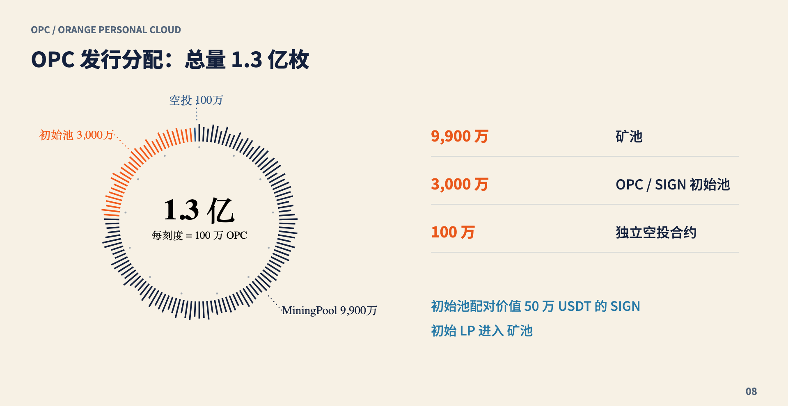
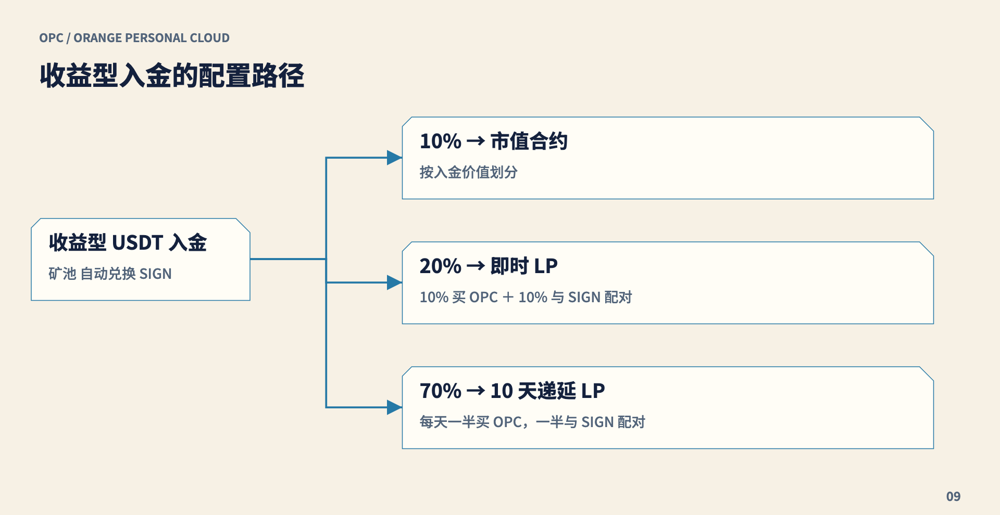
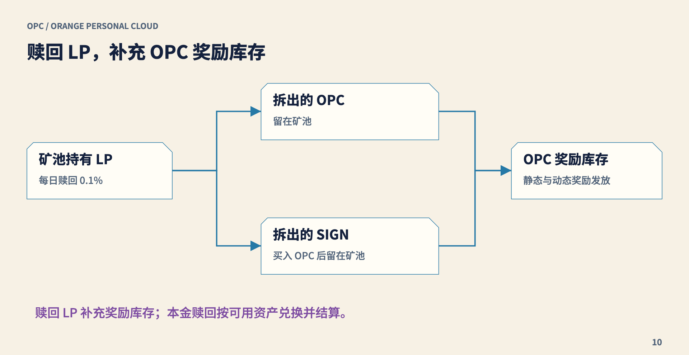
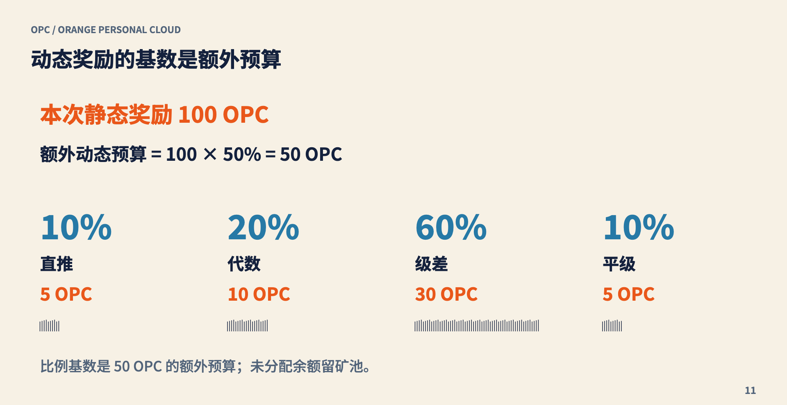
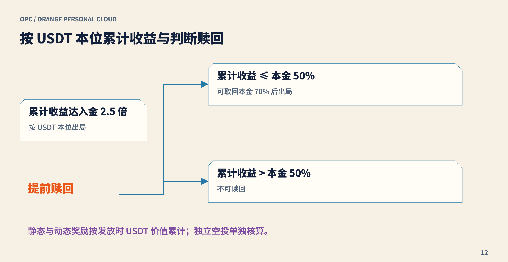

# 经济机制、奖励与退出

### Q079 OPC 总量与初始分配是多少？

OPC 总量为 130,000,000 枚，其中 99,000,000 枚进入矿池，30,000,000 枚用于初始流动性，1,000,000 枚进入独立空投合约，分别约占 76.15%、23.08% 和 0.77%。初始流动性使用这 3,000 万枚 OPC 与价值 500,000 USDT 的 SIGN 配对，形成的初始流动性份额进入矿池。三项分配覆盖完整总量，分别承接矿池、流动性与新用户空投用途。每项用途都有明确数量，对照分配图即可看清各部分在总量中的位置。

*图：总量为 130,000,000 OPC，按矿池、初始流动性与独立空投用途分配。*

### Q080 初始流动性与矿池是什么关系？

初始流动性由 30,000,000 OPC 与价值 500,000 USDT 的 SIGN 配对形成，所得流动性份额随后进入矿池。总量分配中的 99,000,000 OPC 是另一项矿池份额，初始配对用币已经包含在总量中。阅读资产安排时，先看代币分配用途，再看配对后的资产形态与存放位置，就能把 OPC 数量、SIGN 价值和流动性份额连成一条清楚的资产路径。

### Q081 一笔 1,000 USDT 的收益型入金如何分配？

收益型 USDT 入金进入矿池后自动换成 SIGN，再按价值分配：10% 进入市值合约，20% 用于即时流动性，70% 用于十天递延流动性。以 1,000 USDT 为例，分别对应 100、200 和 700 USDT。即时部分中，100 用于买 OPC，另外价值 100 的 SIGN 与其配对。即时与递延部分分别配置并记录执行进度，让用户从同一笔本金看清各段资产安排。

*图：收益型入金自动转换 SIGN，再按价值的 10%、20%、70% 进入对应路径。*

### Q082 70% 的十天递延流动性怎样配置？

收益型入金价值的 70% 在十天内分批配置，每天按照实际执行金额，一半买入 OPC，另一半对应 SIGN 与其配对，并披露每日进度。以 1,000 USDT 为例，递延部分合计对应 700 USDT，具体每天配置多少由当日执行安排体现。用户将每日记录与递延总额一起查看，即可了解已经形成的流动性和后续配置进度，十天分批执行也保留了各次投入的清楚记录。

### Q083 矿池每日赎回 0.1% 流动性份额后发生什么？

矿池每日赎回 0.1% 流动性份额，得到的 OPC 留在矿池，得到的 SIGN 买入 OPC 后也留在矿池，形成奖励库存。这个过程将已经持有的配对资产转换为 OPC，供奖励机制使用。用户可以沿着流动性份额、赎回资产与奖励库存理解资产变化，分别看清持仓形态和支付用途。库存转换与服务结算各自记录，共同保持资产流向和业务收入之间的清楚关系。

*图：每日赎回 0.1% 流动性份额后形成 OPC 奖励库存，属于已有资产转换。*

### Q084 静态奖励怎样计算和换算成 OPC？

静态日率在 0.5%～1% 区间，按结算期公示适用值。日应计 USDT＝本金 USDT×当期日率，发放 OPC 数量＝应计 USDT÷当期公示的 OPC 换算价。换算价采用结算期公示的 OPC/SIGN 配对折算 USDT 参考价，并记录时间与取价依据。每次结算保留计价和币量记录，后续价格变动不追溯已记录收益，让本金、日率、计价值与实际发放数量逐项对应。

### Q085 动态额外预算如何计算？

动态额外预算＝本次静态奖励 OPC 数量×50%。若静态奖励为 100 OPC，动态额外预算就是 50 OPC；以这 50 为基数，直推 10% 为 5 OPC，代数 20% 为 10 OPC，级差 60% 为 30 OPC，平级 10% 为 5 OPC。各类预算按已生效的关系与等级分配，同类别总发放不超过其预算，未满足资格的余额留在矿池，使额外预算与具体发放分别可查。各项预算相加为 50 OPC，完整对应本次动态额外预算。

*图：静态奖励 100 OPC 对应动态额外预算 50 OPC，内部再按 10%、20%、60%、10% 划分。*

### Q086 动态分配、等级快照和复投怎样衔接？

动态预算分别形成直推、代数、级差和平级类别预算，按已生效的关系与等级逐层结算。等级在结算期开始时快照，同类别发放受对应预算约束，未满足资格的余额留在矿池。复投视为新一笔参与，按新记录的本金、计价和结算条件处理，旧收益保持原记录。这样每期的资格与分配有固定依据，新参与也能够独立追踪，避免同一收益重复计算。

### Q087 新用户空投的规模和发放规则是什么？

独立空投合约配置 1,000,000 OPC，每日由合格新用户均分 10,000 OPC，以首次达到 200 USDT 资格的参与记录认定，每个合格新用户参与一次。每日发放以上述安排与合约剩余库存为限，当日没有合格用户则留存，库存用尽即结束该轮空投。个人获得数量随当日合格人数变化，空投记录独立于静态与动态收益，为新参与者提供清楚的一次性领取规则。

### Q088 200 USDT 的空投资格门槛怎样认定？

空投资格以新用户首次达到 200 USDT 资格的参与记录为准，每位合格新用户只参与一次当日均分。认定后，按照当日合格人数分配当日空投，领取额度同时受到合约剩余库存限制。这里的门槛服务于新用户空投，AI 套餐则按购买页面所列服务额度与有效期使用。两类规则分别对应矿池参与与服务消费，让用户能够清楚了解自己的资格来源和领取记录。

### Q089 累计收益达到 2.5 倍出局怎样计算？

累计收益达到入金的 2.5 倍后，该笔参与出局。累计项包括静态和动态奖励，按每次发放时记录的 USDT 价值相加，独立空投不计入，后续币价变化不追溯重算。以本金 1,000 USDT 为例，对应累计收益阈值为 2,500 USDT。SIGN 上涨时也保持 USDT 本位，用户可以沿着逐次发放记录查看进度，使奖励价值与退出判断使用一致的核算基础。

*图：累计收益达到 2.5 倍触发出局；本金赎回另有 50% 收益边界与 70% 取回规则。*

### Q090 什么情况下可以取回 70% 本金？

累计收益不超过本金 50% 时，可以取回本金的 70%，随后关闭该笔参与；累计收益超过本金 50% 时不可按这条规则赎回。赎回从矿池可用资产按流程兑换 USDT 结算，流动性不足的申请按提交顺序进入队列，按可执行金额分批完成，并展示待处理状态。服务额度退款另走服务账户，不改变该笔本金，使消费退款与矿池退出各自对应清楚的记录。

### Q091 本金 1,000 USDT 时，50% 的赎回边界怎么算？

本金为 1,000 USDT 时，50% 的边界是累计收益 500 USDT。收益等于或低于 500，可取回本金 70%，即 700 USDT，随后关闭该笔参与；高于 500，则不满足提前赎回条件。累计收益按照已发放静态与动态奖励的 USDT 记录相加，空投不计入。符合条件的申请由矿池可用资产结算，流动性不足时按队列分批处理，用户可以查看相应进度。

### Q092 买入税、卖出税与盈利怎样计算？

买入税为 0，卖出税在 8%～49% 区间，按交易时展示的适用税率执行。卖出页面给出对应明细，盈利以结算前记录的成本与卖出价值计算，用户在交易时能够核对计税金额和税额。税收净额再进入对应分配路径。交易税与服务额度消耗分别记账，用户将交易明细与自己的成本记录一起查看，可以把卖出价值、盈利及实际扣税之间的关系核对清楚。

### Q093 卖出税怎样分配？

卖出产生的税收净额按 50% 分配给 V4～V8、20% 进入市值钱包、10% 用于社区奖励、20% 进入生态基金，四项合计为税收净额的 100%。这些比例以实际税收净额为基数，再进入各自类别。用户查看交易时，先核对卖出适用税率和税额，再看税收净额如何分配，就能把一次交易与等级分配、社区奖励和生态用途连成清楚的资金路径。

### Q094 跌幅达到 49% 时，哪些奖励会停止或清零？

跌幅达到或超过 49% 时，停止当期奖励发放，并清零该期未结算奖励；已经支付的收益和账户中的代币余额保留，不追溯清零。用户查看记录时，应区分已支付资产与当期未结算奖励，两者对应不同状态。这项安排作用于当前奖励结算，卖出税则按交易时展示的税率计算，分别记录触发与结算结果，让奖励变化和交易明细各有清楚依据。

### Q095 流动性转换、服务收入与奖励库存怎样协同？

流动性份额赎回后转成 OPC 奖励库存，承接矿池奖励支付；AI 服务费用先结算对应模型、工具与服务成本，承接真实业务使用。两类资金动作分别核算，矿池沿既有库存机制发放奖励，服务账户按购买、消耗和退款记录服务权益。用户从项目工作看服务交付，从矿池记录看资产转换与奖励，能够把产品使用和机制参与放在同一生态中清楚理解。

### Q096 怎样通过结算记录掌握参与进度？

每笔参与围绕本金、适用日率、参考换算价、奖励发放和累计 USDT 价值形成记录，动态奖励同时对应结算期开始的等级快照。十天递延配置披露每日进度，赎回申请显示待处理或分批结算状态。用户沿着这些记录，可以了解资金如何配置、奖励如何计入，以及距离退出条件还有多少进度。复投建立新记录，服务消费使用独立账户，让各项安排保持清楚衔接。
