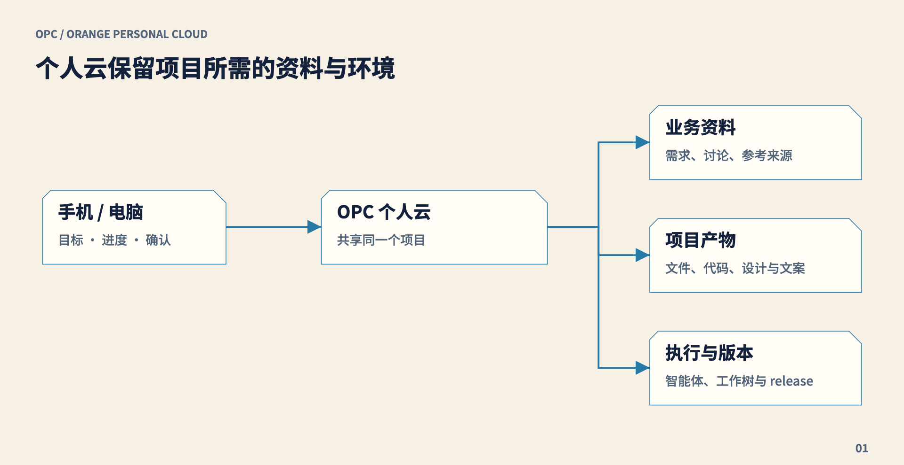
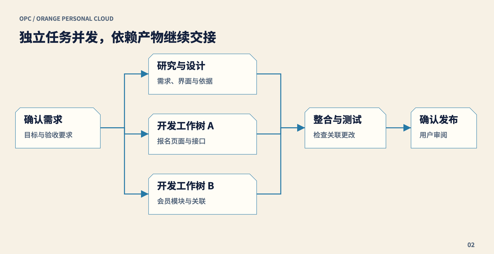
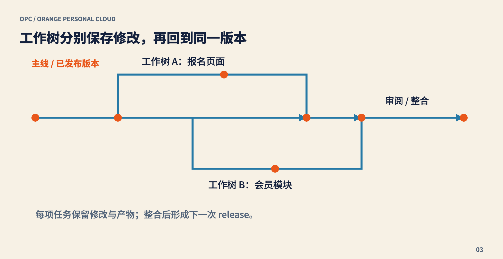
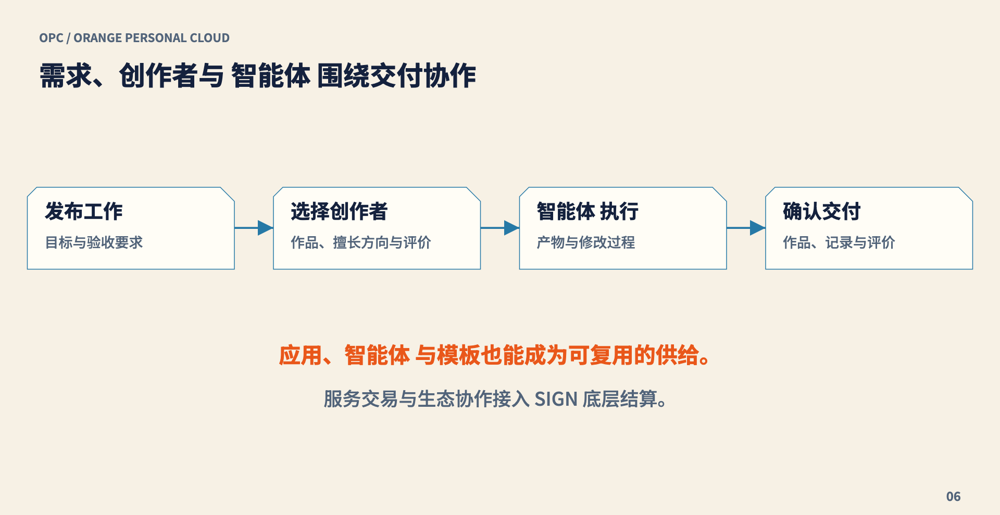
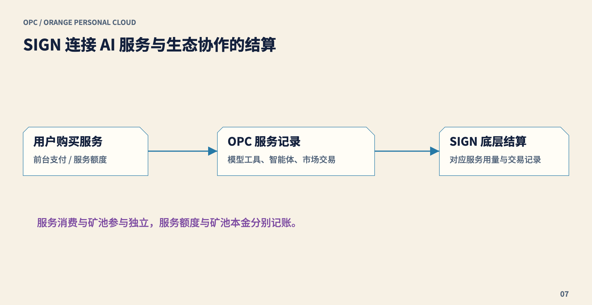
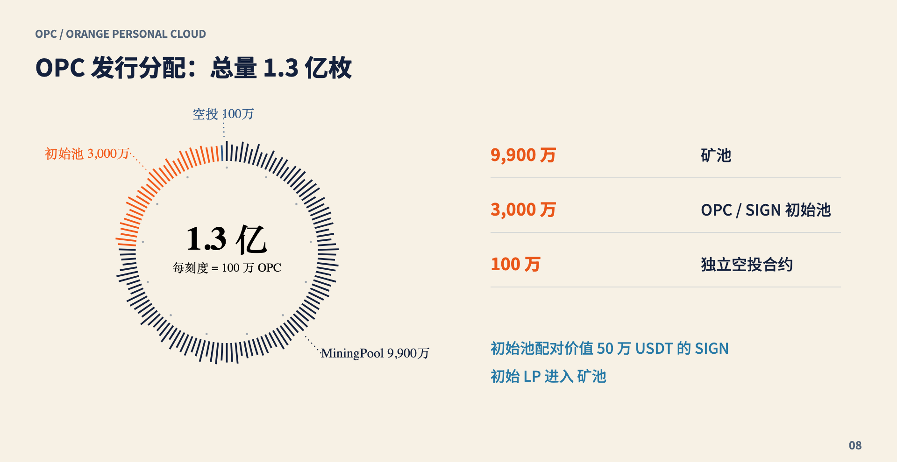
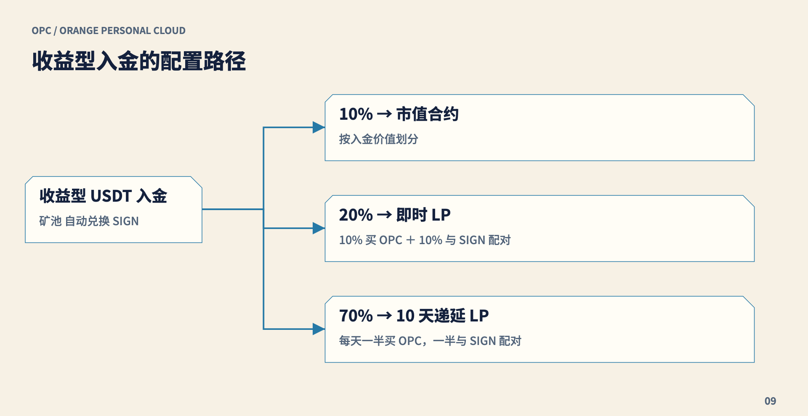
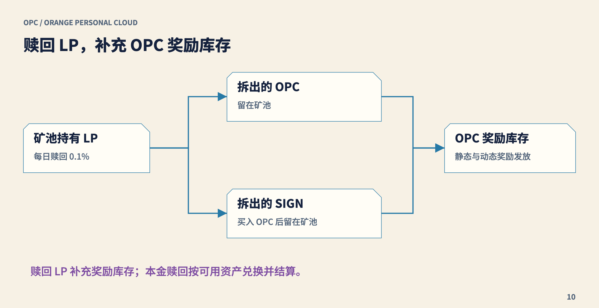
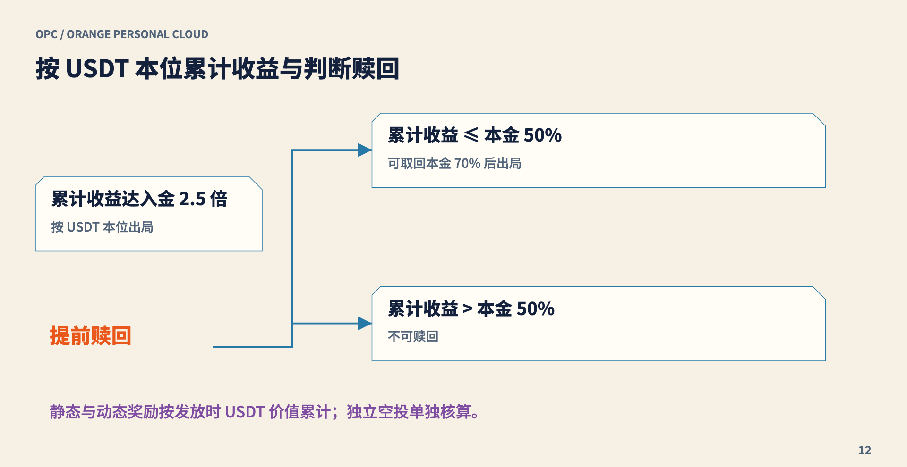

# 一文读懂 OPC：把想法做成产品，在个人云里持续经营

创业者准备办一场活动，最初的想法很直接：做一个报名页面，让会员报名，方便管理活动，再导出签到名单。等到真正开始做，工作很快展开。页面需要设计，报名和会员需要关联，已有资料要交给开发，新版本要检查；上线以后，还要准备宣传文案、回应群里的问题，把下一场活动需要的修改继续做出来。

**Orange Personal Cloud，简称 OPC，把这些工作放进同一片个人云。** 用户说清目标，多个智能体（agent）共享项目背景，并发推进能够分开的任务；更改保存在独立工作树中，经过整合与验收，应用默认发布到个人云。机组接着为新版本准备发布说明、文案与海报，经用户确认后发布到社交媒体，业务群里的反馈又进入原项目，成为下一轮工作的起点。

本文介绍 OPC 的产品流程与机制设计。这套从构思、开发到上线与经营的完整流程已经连通。OPC 提供持续工作的环境、协作方式与应用市场，SIGN 承接 AI 服务和生态交易的底层结算，OPC 代币则承担本模型的发行与奖励发放。理解它们如何围绕实际工作相连，也就理解了个人云的产品方向和经济机制。

## 想法进入个人云，工作就有了可以继续的位置

回到活动报名与会员管理应用程序。创业者在手机上提出目标：“我要做一个活动报名应用程序，允许会员报名、管理活动与导出签到名单。”这句话给出业务方向，接下来需要明确服务对象、用户流程、功能范围与本轮验收要求。哪些页面属于当前版本，报名与会员身份怎样衔接，交付时应查看哪些界面与测试结果，都需要在项目中说清楚。

OPC 将需求、业务资料、项目文件、执行环境、产物与版本留在个人云。手机提供轻量入口，让用户表达目标、看进度、审阅修改；换到电脑后，继续打开同一个项目，沿着已有资料和更改记录推进。承接工作的云端环境，让一段手机上的业务讨论能够接到电脑上的版本审阅，也让一次发布之后的修改有据可循。

*图：手机与电脑连接同一个个人云项目。需求、文件、智能体任务、工作树和发布记录共同构成后续工作的基础。产品场景示意。*

这对创业者的意义十分具体。活动结束后准备办下一场，不必从空白对话重新解释业务；会员提出新需求时，机组能够带着原来的页面、功能和验收要求继续工作。个人云保留的，是一项业务从想法走向产品、再从产品走向经营所需要的连续背景。

OPI 是这片个人云里的橙色 AI 小机长。橙色头盔、向上箭头和身边的小无人机，把机组协作变成容易识别的品牌形象。用户从进入任务到查看进度、审阅产物和确认新版本，都能看到这种陪伴式引导。机组负责执行，用户掌握方向、验收与发布决定。

## 多个智能体同时推进，交接靠得见的产物

活动应用程序确认范围后，可以分开的工作同时展开：设计工作准备报名与会员页面的界面方案，开发任务分别处理报名页面与会员功能，测试工作检查整合后的用户流程。它们共享需求、已有资料与验收要求，任务之间的依赖决定何时可以并行、何时需要等待上一份产物。

例如，报名功能与会员功能可以在各自明确的范围内推进；需要联通会员入口和报名流程时，就要查看双方的更改并进行整合。界面设计、业务逻辑、测试检查也可能随着项目需要重新分工。机组规模与角色围绕具体工作调整，协作的基础始终是共同的项目背景和可交接的成果。

*图：同一阶段中可以独立推进的任务同时展开，有依赖的工作在对应产物就绪后继续。分支表示工作关系，不代表固定数量的智能体。产品场景示意。*

并发之后，创业者需要能够看清每项修改。OPC 用独立工作树保存不同任务的更改：报名页面在一个工作树里推进，会员功能在另一个工作树里推进，再回到同一项目中审阅、整合和检查。需求说明、界面方案、代码更改与测试结果，分别回答“要做什么”“做成什么样”“改了哪里”和“是否达到要求”。

工作树让执行过程留下可审阅的版本材料，也把多项并发修改接回一个可发布的应用。用户提出调整时，智能体可以沿着相关更改继续处理；进入发布前，用户能够结合界面、功能与测试结果作出判断。每次决定都和对应版本相连，下一轮修改因此有清楚的起点。

*图：不同任务分别保留更改，再整合到应用版本。完成一轮交付，也保留继续开发所需的资料与环境。产品场景示意。*

在这个过程中，创业者持续参与产品判断。目标是否清楚，当前范围是否适合第一版，界面和功能是否满足活动组织需要，都由用户确认。智能体承担执行与修改，让一个人能够围绕同一项业务组织更多工作，把精力集中到需要经营者作决定的地方。

## 默认发布到个人云，发布之后继续接住反馈

应用完成整合与验收后，默认发布到 OPC 个人云，版本与运行环境留在项目中。对于活动组织者，上线意味着报名产品进入实际使用，也意味着后续经营工作开始展开。用户需要告诉会员新应用能做什么，解释入口和流程，并收集使用过程中的回应。

机组会接着准备版本发布说明、传播文案与海报。用户确认后，可向 X/Twitter、Facebook、小红书等社交媒体发布新进展。产品更改因此带上相应说明，传播内容能够围绕刚刚完成的版本展开。执行服务和内容工作留在同一项目，也让下一次发布延续既有业务背景。

假设活动业务群里出现一条反馈：“报名页增加会员入口。”OPC 工作台通过 API 读取已获授权的 Telegram、WhatsApp 业务对话，把需求和反馈交给正在工作的智能体。这条消息可以关联到原项目，接下来明确入口位置、报名衔接及验收要求，再分别推进界面更改、功能修改与测试检查。

这里的群聊连接具有明确的业务边界：读取的是用户授权的业务对话，进入的是相关项目的工作背景。用户仍然决定需求如何处理、版本是否通过，以及传播内容是否发布。群里的讨论变成可追踪的修改，发布后的回应继续带回项目，让应用沿着真实使用中的问题向前推进。

对于活动应用程序，这意味着第一版上线以后，会员入口调整可以沿用现有报名和会员模块；准备下一场活动时，已有版本、业务资料与上一轮反馈都在原处。一次交付累积的成果，能够直接支持下一轮交付。

## 从自己的应用程序，走向需求与能力相遇的市场

个人云也连接着应用市场。创业者可以发布工作，写清目标、需求与验收要求，查看创作者的作品与评价，选择合适的供给。创作者接受委托，用智能体推进执行和修改，再把产物交给需求发布者审阅，确认交付。进度、作品与评价随着协作积累，让后来者可以依据可见的交付经历选择合作对象。

*图：需求发布者、创作者和智能体围绕具体工作协作。作品、进度与评价留在市场中，成为后续合作的参考。产品场景示意。*

活动应用程序的创业者可以在自己需要帮助的环节引入创作者。创作者则可以把已经成熟的应用、智能体或模板上架，供更多用户使用。一次工作中形成的方法和能力，因而有机会成为别人的项目起点；用户获得应用和服务，创作者持续展示作品，生态伙伴也可以围绕具体项目接入业务工具与专业服务。

市场与个人云相互连接：需求在项目里被讲清楚，产物通过工作树和版本进入交付，完成的能力又能进入市场。OPC 以这种方式把使用者、创作者和服务供给放到真实工作周围。市场中的服务交易，与项目里的模型调用、工具使用和智能体执行一样，需要相应的价值结算。

## SIGN 让服务之间的价值交换有共同基础

SIGN 是 OPC 的 AI 底层结算代币。用户在前台可以通过法币或额度等方式购买和使用服务，平台根据服务用量与生态交易记录，通过 SIGN 完成底层结算。用户选择的是当前工作需要的服务，模型、工具、智能体与创作者的协作则接入共同的结算路径。

活动应用程序的一次迭代，可能包含模型与工具调用、多个智能体的任务执行，也可能包含创作者提供的市场服务。项目产物说明工作完成到了哪里，服务用量与交易记录则为结算提供对应依据。随着更多应用、创作者和专业服务进入个人云，SIGN 可以参与更多实际工作的底层价值交换。

*图：前台的购买方式连接服务使用，模型、工具、智能体与市场协作的记录接入 SIGN 底层结算。服务消费与收益型入金分别按各自规则处理。*

OPC 与 SIGN 因而各有明确职责。个人云承接产品工作和生态协作，SIGN 在服务层承接结算；在后述收益型入金模型中，SIGN 还承担 USDT 入金后的中间交换与流动性配对。OPC 代币承担本模型的发行和奖励支付。理解这些角色，有助于分别看清产品使用、服务交易和奖励机制中的资产流向。

购买 AI 服务获得相应服务额度，费用进入服务结算，用于支付对应模型、工具及服务成本。收益型入金独立进入矿池的资金分配流程，用户根据自己的需要选择参与。服务消费按服务账记录，矿池参与按本金、奖励与退出记录核算，购买服务本身不自动入矿池，也不自动取得收益资格。

套餐购买页面列明支付方式、服务额度和有效期，使用服务时扣减额度。申请服务退款时，未使用部分按剩余额度比例原路退回，已经消耗的服务不退款。这笔退款在服务账处理，独立矿池本金保持原有记录。创业者可以据此分别管理活动应用程序的工作预算和自己的矿池参与，了解每笔支出对应的服务或资产安排。

## OPC 总量与初始资产怎样安排

OPC 总量为 **130,000,000 枚**。其中 99,000,000 枚分配给矿池；30,000,000 枚与价值 500,000 USDT 的 SIGN 配对建立初始流动性，形成的初始 LP 进入矿池；另有 1,000,000 枚进入独立空投合约。

*图：1.3 亿枚 OPC 按矿池、初始流动性与独立空投分配。初始流动性形成的 LP 进入矿池。*

| 分配用途 | OPC 数量 | 对应安排 |
| --- | ---: | --- |
| 矿池 | 99,000,000 | 矿池分配 |
| 初始流动性 | 30,000,000 | 与价值 500,000 USDT 的 SIGN 配对，初始 LP 进入矿池 |
| 独立空投合约 | 1,000,000 | 按新用户空投规则分配 |
| 合计 | 130,000,000 | 固定总量口径 |

这里需要同时看代币分配与资产形态。初始流动性中的 OPC 和 SIGN 配对后，矿池持有的是对应 LP；后续赎回 LP 又会得到相应的 OPC 与 SIGN。代币数量、LP 份额与 USDT 计价金额分别表达不同内容，阅读机制时应沿着资产实际转换的步骤理解。

## 一笔收益型入金，如何分配到流动性

收益型 USDT 入金进入矿池后，自动兑换为 SIGN，再按设计比例分配：10% 进入市值合约，20% 即时添加 LP，70% 在十天内递延添加 LP。SIGN 在这里承担中间交换，后续买入 OPC 和建立配对都沿着这条资金路径进行。

以入金 **1,000 USDT** 为例，按入金价值划分，100 USDT 对应市值合约，200 USDT 对应即时 LP，700 USDT 对应十天递延 LP。即时部分中，入金价值的 10%，即 100 USDT，用于买入 OPC；另外 10%，即 100 USDT 对应的 SIGN，与买入的 OPC 配对。

*图：入金先以 SIGN 完成中间交换，再分配至市值合约、即时 LP 和十天递延 LP。金额按入金价值表达，用于解释分配比例。*

递延部分的 700 USDT 价值在十天内分批添加 LP。每天实际执行的当日资金，一半用于买入 OPC，另一半对应 SIGN，与买入的 OPC 配对；每日执行进度随记录披露。十天规定配置期限，每日金额按实际执行安排变化，形成可以逐日跟踪的配置过程。参与者可以结合总额、当日执行额与累计进度，了解这笔资金已经完成的流动性配置。

实际买到多少 OPC、获得多少 LP，取决于执行时对应的交易和价格条件。

矿池另有每日赎回 0.1% LP 的安排。赎回取得的 OPC 留在矿池，取得的 SIGN 用于买入 OPC 后也留在矿池，形成 OPC 奖励库存。从资产变化看，是 LP 被转换成可用于奖励的 OPC；这一步没有凭空产生新的外部收入。

*图：每日赎回的 LP 分解为 OPC 与 SIGN，SIGN 再买入 OPC，最终留池形成奖励库存。图示表达资产转换，不表达新增经营收入。*

产品层面的 AI 服务消费、SIGN 结算与矿池里的资产转换，分别保留对应记录。服务收入先支付模型、工具及相关服务成本，矿池奖励依照现有 OPC 库存机制发放。活动应用程序调用了哪些能力、市场委托交付了什么、矿池持有哪些资产，各有清楚的核算对象，让业务使用与机制参与都能够沿实际记录理解。

## 静态与动态奖励，分别怎样计算

静态日收益的设计区间为 **0.5%—1%**，按结算期公示适用日率，以入金 USDT 本金计价、以 OPC 支付。日应计金额等于本金 USDT 乘以当期日率，发放 OPC 数量等于日应计 USDT 金额除以当期公示的 OPC 换算价。对于 1,000 USDT 的入金，这一区间对应当日 5—10 USDT 的应计价值，再按该期换算价得到应发 OPC 数量。

换算价采用结算期平台公示的 OPC/SIGN 配对折算 USDT 参考价，并记录使用时间与价格口径。参与者查看一笔奖励时，可以顺着本金、适用日率、应计 USDT、换算价和 OPC 数量逐项理解计算结果。以后价格发生变化，已经记录的收益沿用原发放记录，核算保持连续。

USDT 计价描述核算基础，OPC 支付描述实际发放资产。同样的应计价值，在不同结算期可能对应不同 OPC 数量；每次记录都保留当期换算依据，也为累计收益与出局判断提供统一的价值基础。

动态奖励采用额外预算，本次静态奖励的 OPC 数量乘以 50%，得到本次动态预算；该预算再按直推 10%、代数 20%、级差 60%、平级 10% 划分。未分配部分留在矿池。百分比的基数是动态预算，与静态奖励的 OPC 数量有明确的先后关系。

例如，本次静态奖励为 **100 OPC**，额外动态预算就是 **50 OPC**。预算中的直推部分为 5 OPC，代数部分为 10 OPC，级差部分为 30 OPC，平级部分为 5 OPC，合计 50 OPC。静态 100 OPC 与动态预算 50 OPC 分开表达，避免将动态比例误算成对入金本金直接提取。

| 本次动态预算项目 | 占动态预算比例 | 静态奖励 100 OPC 时的预算 |
| --- | ---: | ---: |
| 直推 | 10% | 5 OPC |
| 代数 | 20% | 10 OPC |
| 级差 | 60% | 30 OPC |
| 平级 | 10% | 5 OPC |
| 合计 | 100% | 50 OPC |

预算按已经生效的关系与等级逐层结算，各类别实际发放总额以该类别预算为上限；资格条件未满足时，对应余额留在矿池。等级在结算期开始时形成快照，当前期按该快照处理，使同一结算期的分配使用共同依据。预算形成、实际发放和余额分别记录，便于跟踪动态奖励如何分配。

复投作为新一笔参与处理，以新记录对应的本金与价格计价。原参与已经获得的收益保留在原记录中，新参与从自己的记录开始累计，旧收益在核算中只计入一次。这样的安排让新增本金、已发奖励与后续收益各有归属，也让每一笔参与能够分别适用退出条件。

## 空投、出局与交易税，把边界放在一起看清

独立空投合约分配 **1,000,000 OPC**，每日分配 **10,000 OPC**。资格以首次达到 **200 USDT** 门槛的参与记录为准，每个合格新用户领取一次；当日额度由当日合格人数均分，实际总发放额以合约剩余库存为上限。当日没有合格用户，额度留存；库存用尽后，该轮空投结束。参与者可以结合资格记录、当日人数与剩余库存理解自己的分配结果。

收益型模型以 USDT 为核算本位，累计收益达到入金的 **2.5 倍**时出局。累计范围包含静态与动态奖励，按每次发放时记录的 USDT 价值逐笔累加，独立空投不计入其中。SIGN 或 OPC 后来涨跌，已记录收益沿用原计价值，出局阈值继续以 USDT 本金为基础。

以入金 1,000 USDT 为例，2.5 倍对应累计收益出局阈值 2,500 USDT。每次静态与动态奖励的发放记录共同构成累计数，达到阈值后关闭该笔参与的收益资格。服务额度的使用与退款在另一套服务记录中处理，保持产品消费与矿池参与之间清楚的账目关系。

提前赎回则有另一项条件：累计收益不超过本金的 50% 时，可以取回本金的 70% 后出局；累计收益超过本金的 50% 后，不可按这条规则赎回。仍以 1,000 USDT 为例，累计收益小于或等于 500 USDT，符合该条件时可按规则取回 700 USDT 后出局；超过 500 USDT，则不满足提前赎回条件。

*图：2.5 倍出局与提前赎回分别按对应条件判断。示例本金为 1,000 USDT，静态与动态奖励按发放时记录的 USDT 价值累计，独立空投不计入。*

本金赎回从矿池可用资产按流程兑换 USDT 结算。可用流动性不足时，申请进入按申请顺序处理的队列，按可执行金额分批完成，并公开待处理状态。参与者可以查看申请所处进度和已经执行的金额，到账随实际可执行的流动性安排推进。提前赎回完成后，关闭对应参与记录；服务消费退款继续独立处理。

交易税设计为买入税 0，卖出税区间 **8%—49%**，按交易时展示的适用税率执行。税收净额按 50% 分配给 V4—V8，20% 分配给市值钱包，10% 分配给社区奖，20% 分配给生态基金。分配以税收净额为基数，相关记录承接当次交易的税率与税额。

盈利按结算前记录的成本与卖出价值计算，具体卖出页面展示对应明细，让交易金额、记录成本和适用税费可以放在一起理解。跌幅达到或超过 49% 时，停止当期奖励发放并清零该期未结算奖励；已经支付的收益和用户持有的代币余额保留原有记录。这项规则处理当期未完成的奖励结算，使影响范围与当前结算期相对应。

## 机制怎样持续运行

服务消费、流动性配置、奖励核算与退出，各自有明确的处理规则。运行记录把相关动作接起来：服务账说明额度如何使用，矿池记录说明本金和资产如何变化，奖励记录说明发放依据，退出记录说明参与何时关闭。沿着记录查看，每个数额都能找到自己的基数和所属阶段。

| 运行环节 | 处理规则 |
| --- | --- |
| 服务购买与退款 | 购买页面列明支付方式、额度与有效期；使用扣额度，未使用部分按剩余额度比例原路退款，已消耗服务不退款 |
| 矿池参与 | 与服务购买独立建账；服务消费不自动入矿池，服务退款不改变矿池本金 |
| 递延配置 | 70% 入金价值在十天内分批配置，当日执行额各半用于买入 OPC 与 SIGN 配对，披露每日进度 |
| 静态核算 | 本金 USDT×当期公示日率得到日应计 USDT，再除以当期公示 OPC 换算价得到支付数量 |
| 动态分配 | 静态 OPC 数量×50% 形成额外预算，按类别预算、已生效关系及期初等级快照结算，未分配留池 |
| 复投记录 | 作为新一笔参与计价与累计，旧收益保留原记录，不重复计入 |
| 累计收益与出局 | 累加发放时记录的静态、动态 USDT 价值，独立空投不计入，达到本金2.5倍关闭收益资格 |
| 提前赎回 | 累计收益≤本金50%时取回本金70%后关闭参与；流动性不足时按申请顺序分批处理 |
| 空投分配 | 合格新用户一次，当日均分且以剩余库存为上限；无人合格留存，库存用尽结束该轮 |
| 当期奖励调整 | 跌幅达到或超过49%时，停止当期发放并清零该期未结算奖励，保留已支付收益与代币余额 |

对于使用活动应用程序的创业者，服务购买和额度消耗对应日常工作；对于矿池参与者，本金、奖励与退出按独立记录处理。SIGN 在服务结算和收益型入金中分别承担对应职责，OPC 依照分配与库存规则参与奖励支付。把规则落实到具体记录，产品使用和机制运行就有了可以持续跟踪的依据。

## 把一轮交付，变成持续经营的基础

活动报名与会员管理应用程序的故事，从一句业务目标开始，经过共享项目背景中的并发执行、独立工作树中的版本更改，走到个人云里的上线应用。随后，版本发布说明和海报让进展进入社交媒体，获授权业务群里的反馈重新进入项目，创作者和市场能力在需要时参与下一轮交付。

OPC 把方向判断、执行产物和后续经营接在一起。创业者拥有可以持续推进的项目，创作者拥有展示作品与提供服务的市场，SIGN 贯穿 AI 调用和生态协作的底层结算，OPC 奖励机制则以明确的发行、流动性与分配口径展开。每个环节对应具体工作或资产流向，共同构成个人云的产品与经济框架。

从想法到应用程序，再到下一次迭代，已经完成的工作留在个人云里，成为继续经营的基础。

**官方渠道：** [项目资料库](https://library.orangepilotcrew.com) · [GitHub](https://github.com/OrangePersonalCloud) · [Telegram](https://t.me/OrangePersonalCloud)

*本文为 OPC 产品与机制设计说明。活动应用程序及图示为场景示意，用于解释工作过程。*
