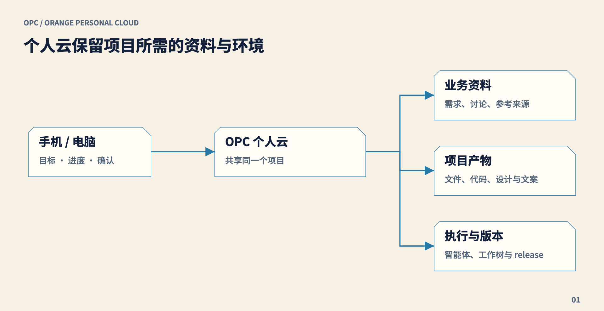

# 02 个人云：项目持续工作的地方

OPC 个人云承接项目的资料、执行与进展。需求说明、业务背景、项目文件、智能体任务、工作树、更改记录和应用版本围绕同一个项目保留，手机与电脑提供轻量入口。用户在不同终端之间切换时，继续处理的是同一项业务。理解个人云，可以从“下一次打开时，哪些工作还在”开始：已经确认的目标、正在执行的任务、需要审阅的产物，以及上一版应用都应有清楚的位置。

图01 展示终端入口与个人云的分工。项目资料、执行与版本、进度与发布归属于个人云；手机和电脑连接这些工作。图中的结构是产品场景说明，帮助用户理解同一项目怎样在不同终端之间继续。

## 把业务背景放在项目中

活动应用的业务背景会随着经营不断增加。早期需求可能只是“会员能够报名，管理员能够导出签到名单”，之后会加入活动介绍、会员入口的位置、常见咨询和上一轮发布反馈。如果这些内容只散落在聊天中，每次修改都会依赖用户重新解释。个人云把与项目有关的背景和产物留在一起，让新任务能够知道前一轮做了什么、这次希望改变什么、哪些要求仍然有效。

项目背景的价值体现在具体判断中。设计会员入口时，需要知道活动页面的主要动作是什么；开发报名功能时，需要知道会员信息如何参与报名流程；准备发布文案时，需要知道这次版本实际改变了哪些体验。同一份业务背景在不同工作环节中承担不同作用。保留背景能够减少理解断层，而清楚的需求与验收仍然决定本次任务的范围。业务背景的积累应帮助执行聚焦到项目目标。

个人云也保留工作结果。需求说明、界面方案、代码更改、测试结果和传播素材分别服务于不同阶段，却共同指向一次交付。用户审阅时可以把这些结果放在一起判断：界面是否承接了需求，功能是否体现了界面方案，发布说明是否准确描述了已完成内容。下一次修改则可以从这些产物继续，无须把项目重新还原成一段口头介绍。

## 轻量入口与云端工作的分工

手机适合表达目标、查看进展和作出较轻的确认，电脑适合集中查看界面、代码和较完整的产物。OPC 把执行环境、项目文件和版本记录留在云端，让这两种入口服务于相同项目。用户在路上收到业务群反馈，可以先说明“下一版需要让会员更容易找到报名入口”；稍后在电脑上查看界面与更改，再决定是否发布。场景中的便利来自工作状态被保留，终端承担的主要任务是进入工作和参与判断。

这种分工对于个人经营有直接意义。创业者的日程常常被沟通、活动现场和客户服务切开，很难连续守在一台电脑前。如果每次切换设备都需要重新整理资料，碎片时间很难形成进度。项目留在个人云后，用户可以围绕当前阶段参与：前期补充需求，中期审阅设计，后期确认版本。能够参与哪一步，取决于工作的实际内容，产品不会把经营者变成全天候观察执行过程的人。

| 位置 | 承接内容 | 在活动应用场景中的作用 |
| --- | --- | --- |
| 手机、电脑入口 | 目标表达、进度查看、产物审阅与确认 | 随时提出会员入口调整，集中检查新版本 |
| 项目资料 | 需求、业务背景、已有文件与产物 | 让各项任务理解报名和会员的关系 |
| 执行与版本 | 智能体任务、独立工作树、更改记录 | 保存并行修改，并为整合提供依据 |
| 进度与发布 | 工作进展、应用版本与发布结果 | 连接本轮交付和下一轮反馈 |

## 持续经营需要连续的项目

应用上线之后，个人云继续承接经营。新活动带来新的报名需求，会员提出更方便的入口，创作者可能提供新的模板。用户可以在原项目中提出修改，让智能体依据已有材料推进，再经整合与确认更新个人云。项目因此拥有连续的工作脉络：为什么改、改了什么、如何形成新版本，以及发布时向外界说明了什么。

个人云也承接完成工作所需的服务。模型与工具调用、智能体执行和可能发生的市场协作，都属于项目中的具体服务活动，SIGN 为它们提供共同的底层结算基础。项目资料回答“工作为何发生、产物是什么”，服务记录回答“哪些能力参与了执行与交付”。两类信息各有用途，共同帮助用户理解一项工作如何从目标走向结果。

OPC 将个人云作为持续工作的载体，让资料、执行、版本和经营相互衔接。对使用者而言，个人云最直观的结果，是每一次返回项目时都能够找到继续推进的起点。
