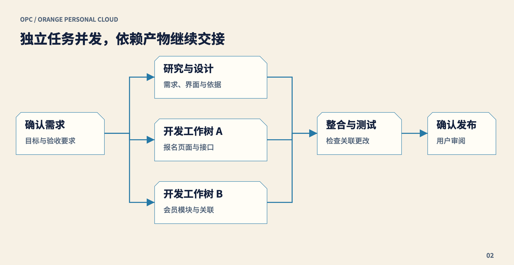

# 03 多智能体协作：把并发变成完整交付

OPC 支持多个智能体围绕同一项目并发推进工作。它们共享需求、已有资料与验收要求，在独立工作树中分别保留更改，再回到同一项目中整合、检查和发布。分工依据任务需要组织，研究、设计、开发、测试或内容制作都可以参与其中。不同角色能够调整组合，项目不被限制为固定数量的智能体，也不要求每次都沿相同顺序逐个执行。

并发的起点是任务关系。活动应用已经明确会员报名流程后，报名页面与会员模块中可以独立推进的部分能够同时展开；需要依据共同接口或界面决定的部分，则应在相关结果形成后衔接。多智能体协作的效率来自识别哪些工作能分开、哪些结果需要等待，以及在交接时保留足够的产物。仅仅增加执行者数量，并不能代替这些判断。

图02 用依赖连线说明任务如何汇合。同一阶段中具备独立条件的分支可以并行，后续整合承接这些分支的结果。图示表达协作关系，具体任务按项目需要组织角色与分工。

## 共同目标让分工能够汇合

在活动应用场景中，需求可以表述为“会员能够从活动页找到报名入口，完成报名后，管理者可以使用签到名单”。这一表述同时给出了对象、动作与交付结果。界面工作关注会员如何发现入口，功能工作关注报名和会员关联，检查工作关注整条流程能否按要求完成。各项任务看到共同目标，才能避免局部完成之后无法拼成一项可用功能。

验收要求应当尽早进入项目。用户需要判断的是实际体验：入口是否清楚，跳转是否符合预期，报名结果是否能够在后续管理中使用。把这些要求交给智能体，可以让执行围绕结果展开。任务完成时交回的产物也有了检视依据：设计说明解释入口安排，代码更改实现相应行为，测试结果说明已检查的路径。这样的协作让进度与完成状态有实际内容。

共享业务背景并不意味着所有任务都反复处理全部资料。需求、已有产物和版本为协作提供共同背景，每项任务再围绕负责的问题推进。例如，编写发布文案需要理解本轮更改和用户收益，并不需要代替开发工作；报名页面开发需要知道会员入口方案，也无须重新制定本周的市场计划。围绕任务选择相关背景，有助于把并发工作保持在可整合的范围中。

## 工作结果决定交接质量

智能体之间的交接应由产物承接。需求工作留下目标和验收要求，设计工作留下界面方案及解释，开发工作留下更改与版本记录，检查工作留下结果，发布准备留下版本说明、文案与海报。用户由此能够看到一次交付是如何形成的，而后续任务可以直接接过已有结果，继续处理尚未完成的部分。

| 工作内容 | 可审阅的产物 | 后续如何使用 |
| --- | --- | --- |
| 需求与设计 | 需求说明、界面方案、参考资料 | 为开发和验收提供共同依据 |
| 报名与会员功能 | 功能更改、项目文件、更改记录 | 进入版本整合，检查流程衔接 |
| 检查与修改 | 测试结果、问题说明、修订产物 | 帮助用户判断是否达到本次目标 |
| 发布与传播 | 版本说明、文案、海报 | 经确认后用于上线与对外沟通 |

当并行分支存在相互影响时，整合成为必需的工作。报名页面与会员模块各自完成，并不等于用户流程已经完成。两个分支需要放回同一版本，查看入口、跳转与功能行为是否一致。用户审阅的对象也从单项产物转向整合后的应用。OPC 通过独立工作树保存更改，为这种整合提供清楚的工作基础，具体关系见[第五章：工作树与版本](05-worktrees.md)。

## 用户决定方向与完成标准

用户在协作中保留关键判断。需求是否值得做、第一版做到什么程度、哪些修改可以接受、何时发布，仍然围绕用户的业务目标决定。用户可以调整目标，也可以要求智能体依据现有产物继续修订。把这些判断留在项目中，可以使一次“请修改”成为能够继续执行的要求，而非重新开始的对话。

对于活动应用，经营者可能决定先提供清楚的会员入口，再考虑更复杂的会员运营功能。这个决定会影响任务范围、设计重点和版本说明。智能体的并发能力服务于已经选择的方向，用户通过查看产物和版本参与过程。产品所强调的“由你掌舵”，正是把经营决策与执行能力放到适当位置，使个人能够组织更完整的工作。

多个智能体同时执行，也意味着项目中可能发生不同模型、工具与专业服务调用。这些服务记录接入 SIGN 的底层结算，让并发协作能够连接相应供给。用户根据产物验收工作，平台根据服务和交易记录结算，执行与价值交换共同围绕项目展开。
