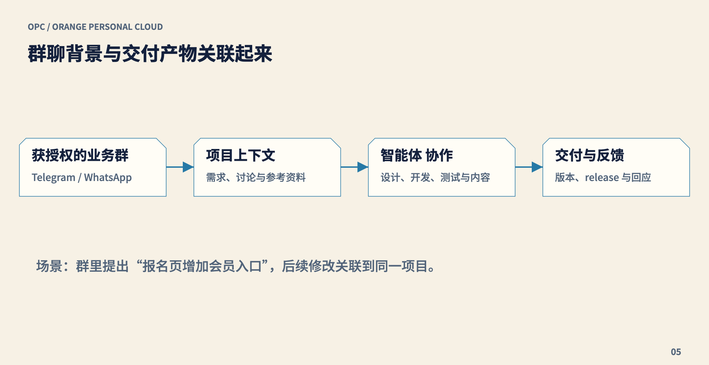

# 04 业务连接：从群聊业务背景走向项目产物

许多业务需求最早出现在日常对话中。活动负责人在 Telegram 群里收到会员建议，合作方在 WhatsApp群中补充报名安排，团队讨论新版本应该如何向外介绍。OPC 工作台通过 API 读取已获授权的业务群中的讨论背景，把需求与反馈交给正在工作的智能体。对话中的信息由此能够进入对应项目，继续形成需求说明、界面更改、功能代码与发布材料。

业务连接的重点是让讨论进入后续工作。会员说“活动页里找不到专属报名入口”，这句话说明体验中的问题，还没有决定入口位置或具体修改方式。项目需要将它与已有页面、会员流程和本轮目标联系起来，再形成可执行要求。智能体带着这些背景继续处理，用户能够审阅修改，并决定是否发布新版本。业务群中的一句反馈由此成为一项有产物、有版本的工作。

图05 表示业务对话、项目背景、需求与执行产物之间的关联。案例中“报名页增加会员入口”为场景示意，连线说明信息如何被后续工作使用，不代表已经存在的真实群聊记录。

## 获授权的背景进入指定工作

授权限定了读取业务对话的范围。OPC 的产品口径是通过 API 读取已授权的 Telegram、WhatsApp业务群中的讨论背景，用户可以据此把相关沟通接入工作台。这项能力使智能体能够了解业务中的真实表达，减少用户在工具之间搬运信息的负担。它不等同于访问用户所有聊天，也不要求将任何出现的信息都转成产品需求。

进入项目后，反馈仍需经过业务判断。活动会员对入口的意见可能非常明确，也可能需要与其他要求一起权衡：活动介绍是否仍然清楚，普通报名与会员报名如何衔接，本轮修改是否影响已有流程。用户说明本次优先解决的问题，智能体再依据项目资料执行。连接器提供背景，项目组织需求，用户确定目标，这些作用相互衔接。

对话与产物关联之后，检查也有了业务背景。用户可以比较原始问题与新的界面：会员是否更容易找到入口，报名动作是否顺畅，发布说明是否准确回答了这次反馈。若仍有差距，可以沿本轮工作继续修改。这样的关联使经营者能够理解“为什么做这项更改”，让外部沟通的声音在交付过程中持续发挥作用。

## 将版本发布变成对外沟通

应用新版本形成后，OPC 可以继续准备发布文案与海报，经用户确认后发布到 X/Twitter、Facebook、小红书等社交媒体。执行链条因此从产品制作延伸到对外沟通：新功能先成为可审阅的应用更改，再成为面向用户解释的内容。传播素材围绕实际发布内容准备，更容易让用户知道这次变化与自己有什么关系。

活动应用新增会员报名入口后，发布说明可以交代入口变化、使用方式与适用场景。海报则需要把这次改进表达得更直观。不同平台的文案与视觉呈现可以依据传播需要准备，但内容应与同一版本发布对应。用户审阅和确认这一步具有实际意义：它使产品变化、品牌表达和发布时间进入同一次判断，随后再由相应发布连接完成动作。

发布之后的回应能够继续进入项目。用户可能提出入口已经更清楚，但还希望活动详情中的会员说明更完整。新反馈与已有版本放在一起，下一轮任务可以沿原项目继续。OPC 由此把“读取业务背景”和“确认后对外发布”放进持续迭代中，让沟通既为产品提供输入，也帮助产品将变化传达出去。

## 用连接减少重复解释

业务连接带来的效率，主要体现为减少业务背景搬运。经营者无需把群里讨论重新整理成另一套孤立材料，也无需在发布前重新回忆本轮到底修改了什么。项目资料和版本为内容工作提供基础，群聊中的回应为下一轮提供线索。工作能否顺畅向前，仍取决于目标是否明确、产物是否符合要求以及确认是否完成。

这一过程也产生具体的服务活动。理解业务背景、准备需求材料、生成文案与海报、执行智能体任务以及使用相关工具，都可以成为项目服务记录的一部分，并由 SIGN 连接底层结算。结算记录承接服务的发生，项目产物承接工作的结果，两者共同服务于持续经营。

OPC 将业务对话与应用项目连接起来，让需求不止停留在沟通里，让版本发布能够进入真实的用户关系。对活动经营者来说，最有价值的变化是同一份业务背景可以持续作用于下一步：先帮助智能体做出合适的修改，再帮助用户准确讲清这次改进，最终把新的回应带回原项目。
