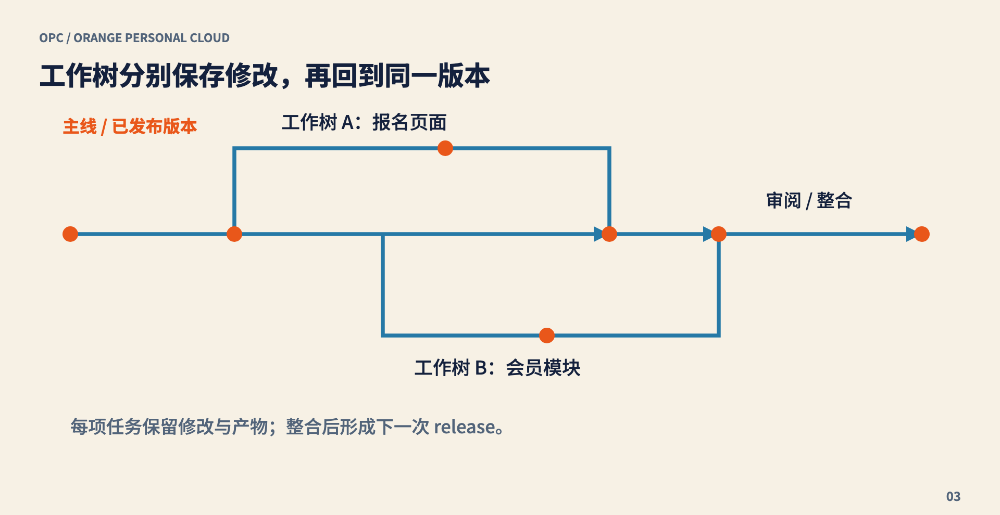

# 05 工作树与版本：让更改能够审阅、整合和继续

OPC 使用独立工作树保存不同任务的更改。多个智能体可以在共同的项目背景下分别推进工作，再将结果带回同一项目中审阅与整合，形成可发布的应用版本。对使用者而言，工作树为并发提供了清楚的边界：报名页面的修改与会员功能的修改各自保留，整合时再检查它们是否共同满足本轮需求。

图03 展示已发布版本、独立工作树与整合后版本的关系。分支代表具体工作中的更改，汇合表示审阅和整合；不同工作留下可审阅的更改，再汇入完整应用。

## 以版本承接变化

活动应用已经有一个可使用的报名页面，现在需要增加会员入口。界面调整会改变用户看到的内容，会员功能调整会影响报名流程中的关联行为。将这些任务分别保留在独立工作树中，可以让执行围绕各自目标展开，也让审阅能够看到具体更改。用户据此判断本轮修改是否符合预期，并把需要修订的意见交给对应工作继续处理。

独立工作树并不取消整合。一个页面按钮已经出现，仍然需要确认它与会员功能的衔接；会员功能已经修改，也需要看整合后的页面是否能够引导用户完成动作。OPC 将各项更改放回同一项目中检查，使用户面对的是一版完整应用。对于个人创业者，这个环节尤其有价值：即使并行任务由不同智能体推进，最终交付仍应围绕同一个用户流程成立。

版本记录还承接了决策。用户可能选择先上线更清楚的入口，把更复杂的会员流程留给下一轮；也可能根据测试结果要求继续修改。把决定落实到产物与版本中，后续工作就能知道哪些内容已经发布、哪些更改仍在处理中。这种连续性有助于减少“以为已经上线”和“仍停留在工作产物中”之间的理解偏差。

## 审阅以本轮目标为依据

审阅更改时，用户可以从需求、产物和整合效果建立联系。需求说明解释为什么需要会员入口，界面方案展示入口安排，功能更改体现实际行为，测试结果提供检查依据。各项信息放到同一版本中，才能支持发布判断。工作树让更改有所归属，验收要求则让审阅有明确方向。

在活动应用的一轮迭代中，审阅可以围绕会员是否容易发现入口、进入后是否能够完成报名、既有活动信息是否仍然清楚展开。这些问题与业务目标直接相关，不依赖读者掌握复杂工程术语。需要进一步修改时，用户可以指出具体差距，让智能体继续处理并保留新产物。版本机制由此为自然语言中的判断提供实际承接。

| 阶段 | 用户关注的问题 | 项目中保留的依据 |
| --- | --- | --- |
| 分工执行 | 每项任务要解决什么问题 | 需求、任务与独立工作树 |
| 审阅更改 | 产物是否体现本次要求 | 界面、文件、代码与更改记录 |
| 整合检查 | 各项修改能否组成完整流程 | 整合版本与测试结果 |
| 发布确认 | 本轮是否已达到交付目标 | 应用版本与版本说明 |

## 给下一次工作留下基础

发布完成后，项目仍然需要继续经营。下一场活动可能提出新的报名字段，会员可能希望入口文案更明确，创作者可能参与改进页面。已有资料、文件和版本为这些新任务提供起点。用户能够基于当前应用表达修改要求，智能体也能够沿已有项目推进，无须将应用重新构建为一次孤立演示。

工作树与版本同时支撑市场协作。创作者接受活动应用的界面委托后，可以围绕明确的需求组织智能体执行，将产物交回审阅。作品能够展示怎样的交付，版本则承接项目中具体发生的修改。应用市场的进度与评价帮助后续用户理解服务能力，SIGN 为相关服务交易和执行活动提供底层结算。交付依据、信誉记录与结算因此各有清楚的对象。

OPC 在产品流程中已经连接独立工作树、整合与发布。并发更改有地方保存，完整版本有依据审阅，应用上线后仍保留继续工作的资料和环境。一轮交付因此能够沉淀为项目的新起点，后续需求可以沿着已有成果继续。
