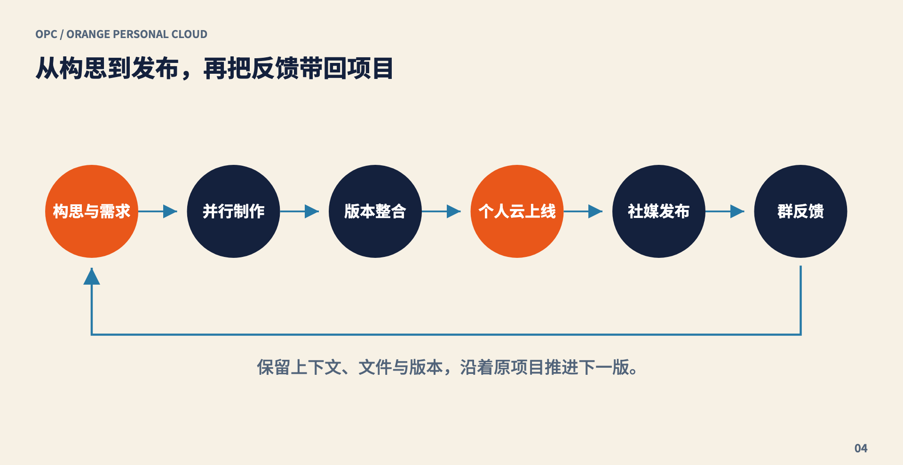

# 06 发布与经营：应用默认发布到个人云

OPC 将构思、并行制作、版本整合和云端发布接入同一产品流程。应用默认发布到个人云，版本与运行环境留在项目中，后续修改可以继续发布。对于希望把活动应用推向真实使用的创业者，这一步把开发产物转成可以进入经营的应用，也为下一次迭代保留了环境和资料。

图04 连接需求、并行制作、版本整合、云端上线、社媒发布与反馈。箭头表示工作衔接，反馈重新进入项目，支持下一轮迭代。每一轮的实际范围由用户目标和验收决定。

## 从可查看的产物走向可使用的版本

发布前，用户需要把本轮结果放在一起判断。活动页看起来完整，会员报名的行为也需要符合要求；版本说明准备好了，其中描述的功能也应出现在应用中。整合与检查为这一判断提供依据，用户确认版本后进入发布。OPC 把这些工作留在同一项目中，使用户能够沿目标、产物、版本与上线结果理解这次交付。

默认发布到个人云，降低了从完成制作到开始使用之间的交接成本。创业者可以直接沿着项目产物与整合版本推进发布，应用版本与环境保留在个人云，新的更改继续在原项目中处理。从当前成果出发，用户可以把注意力放到使用反馈和下一轮需求上。

对活动应用来说，发布目标应与当前业务阶段匹配。第一版可能优先让会员找到活动并完成报名，再根据经营反馈逐步优化体验。用户确认的重点是本轮目标已经达到，后续还有哪些工作需要继续。把范围说清楚，能够使版本说明准确，也让下一轮任务更容易在原项目中展开。

## 新版本连接传播与回应

应用上线之后，机组可以继续准备发布文案与海报，经用户确认后发布到相应社交平台。新版本因此拥有面向用户的解释：这次增加了什么，怎样使用，与参与活动有什么关系。文案和海报从项目中的实际更改出发，帮助经营者将开发进展转成清楚的沟通内容。

传播素材也属于项目产物。用户可以审阅海报与文案，检查它们是否准确说明会员入口的变化，是否与活动的表达一致。确认后发布，接下来的回应再通过已授权业务连接或用户补充进入项目。产品迭代与用户沟通由此相互衔接，经营者能够持续回答两个问题：应用接下来应该改什么，以及已经完成的变化应如何让用户知道。

## 发布之后继续处理业务

持续经营中的任务通常比最初构想更细。入口位置可能需要调整，说明文案可能引发新的疑问，活动管理者可能提出导出名单的使用反馈。这些信息进入原项目后，可以与当前版本比较，形成新的需求，再分派给相关智能体。新一轮工作继承原来的资料和环境，也保留本轮修改的产物与记录。

这一过程让“上线”成为经营中的节点。用户仍然作出方向和发布判断，智能体围绕已有项目持续执行。需要外部专业能力时，可以通过应用市场寻找创作者、应用、智能体或模板；涉及模型、工具和协作服务时，SIGN 承接底层结算。个人云把应用的成长过程留在同一处，市场和服务供给则帮助项目在不同阶段获得所需能力。

OPC 的完整产品流程已经连通。对创业者而言，这条路径可以直接落实到经营动作：说清目标，检查产物，确认版本，让应用在个人云上线，再把真实回应变成下一轮工作。原项目中的资料与环境持续承接这些动作，使产品能够随着业务需要逐步成长。
