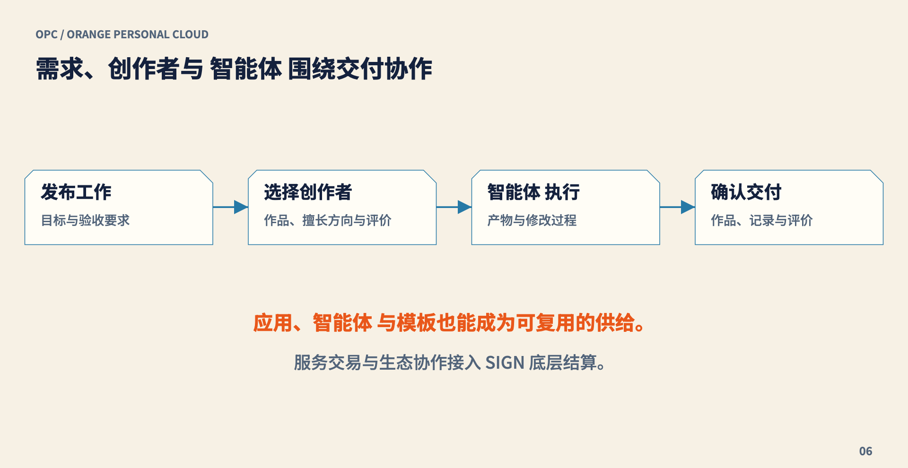

# 07 应用市场：让需求找到能够交付的供给

OPC 应用市场连接需求发布者、创作者与智能体，也承接应用、智能体和模板上架。用户可以发布工作，选择适合的创作者，围绕明确需求推进交付；创作者接受委托，使用智能体完成执行与修改；作品、进度和评价在市场中持续积累。SIGN 连接市场服务交易与底层结算，使项目能够把外部能力接入自己的工作过程。

个人云解决一项工作如何持续进行，应用市场则扩展“谁能够参与完成”。活动应用的经营者可以自己组织智能体开发，也可以在需要更专业的界面或某项交付时寻找创作者。创作者的价值在于把理解需求、组织执行和完成结果结合起来。市场因此围绕交付建立联系，让用户能够在已有作品与具体要求之间找到合适的匹配。

图06 展示需求发布、选择创作者、智能体执行、审阅产物与确认交付的连续关系。进度和评价围绕实际工作积累，帮助发布者了解交付，也为创作者积累可展示的专业记录。

## 发布一项能够承接的工作

清楚的需求能够帮助市场匹配。活动应用经营者如果只说“帮我优化一下”，创作者很难判断工作范围；如果说明希望会员更快找到报名入口，并提供当前页面、业务背景与验收要求，任务就有了可讨论的对象。发布者仍然掌握业务目标，创作者则可以依据要求组织智能体推进。

任务中保留项目背景，有助于减少委托双方的重复解释。已有页面说明当前状态，用户反馈说明修改原因，本轮需求说明交付范围。创作者使用这些材料开展工作，将界面方案、功能更改或其他产物交回审阅。发布者据此提出意见并确认结果，市场记录相应进度与交付表现。

在这个过程中，智能体是执行能力的一部分，创作者承担组织服务与交付的角色。不同工作可以有不同分工：有的任务重在需求判断，有的重在应用制作，有的重在内容与发布准备。应用、智能体、模板与委托服务围绕项目需要参与，具体服务内容与交付要求在任务协作中明确。

## 作品和评价为后续合作提供依据

市场中的信任需要可查看的结果。作品展示创作者曾经完成什么，进度体现当前任务如何推进，评价反映交付后的使用者反馈。这些记录能够帮助用户判断服务方向，也让创作者逐渐形成清楚的能力形象。随着交付积累，市场中的选择可以更多依据具体产物展开。

对创作者而言，一次活动应用的交付还可能形成可复用经验。成熟的页面结构、适合特定业务的智能体或可以重复使用的模板，能够进入市场供更多人选择。上架供给与接受委托各有价值：前者把已有成果带给新用户，后者围绕特定需求提供服务。两种参与方式共同扩大个人云能够调用的能力范围。

复用也需要尊重任务的实际差异。某个模板适合活动报名，不代表它已经覆盖每个经营者的会员流程；某个智能体能完成一类工作，也需要结合新项目背景执行。市场让用户找到更合适的起点，项目背景和验收要求再把供给引向本次交付。这样能够让复用与定制保持清楚关系。

## 服务交易连接 SIGN

市场中的服务交易通过 SIGN 接入平台底层结算。用户前台可以使用法币或额度等购买方式，具体服务记录则与模型调用、工具使用、智能体执行及创作者协作相衔接。统一结算基础为不同类型的供给提供共同连接，使用户可以围绕项目选择能力，而不必把每种服务理解为完全独立的系统。

OPC 应用市场的增长方向是让更多能交付的能力进入同一市场。需求发布者获得更丰富的选择，创作者将专业经验转成作品与服务，应用和模板通过复用触达新场景，SIGN 为服务之间的价值交换提供底层结算。每一次清楚的需求和可见的交付，都有机会为下一次合作建立基础。
