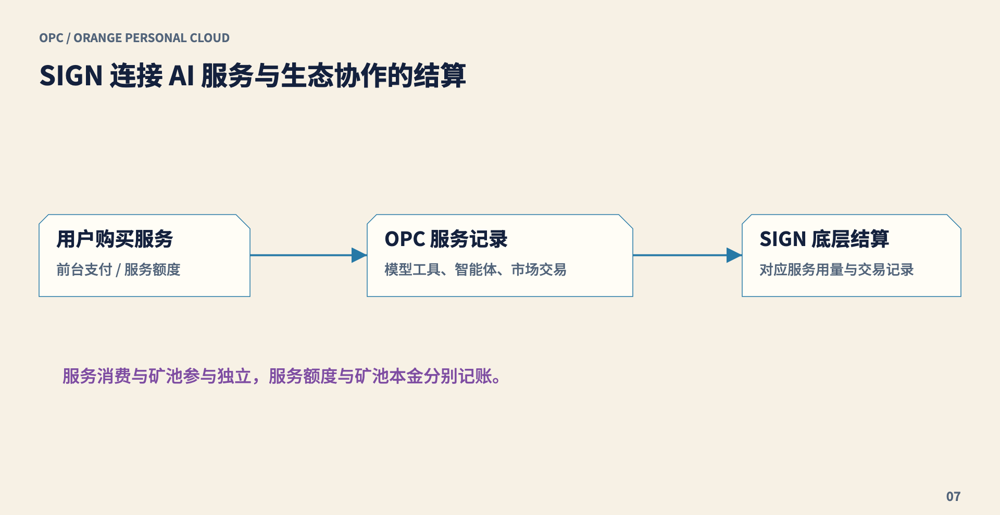

# 08 SIGN：贯穿 AI 服务与生态协作的底层结算

SIGN 在 OPC 中承担 AI 底层结算代币的角色。一个项目会调用模型与工具，运行多个智能体，也可能使用市场中的应用、模板或创作者服务。OPC 根据这些服务用量与生态交易记录连接底层结算，用户前台可以通过法币或额度等方式购买服务。个人云提供工作的场景，SIGN 为不同服务之间的价值交换提供共同基础。

图07 连接前台购买方式、项目服务记录与 SIGN 底层结算。用户按工作需要购买服务，平台围绕模型、工具、智能体和市场交易组织结算，让不同供给参与同一项目。

## 从具体服务理解结算

活动应用的一轮工作中，智能体先理解需求，再准备界面方案，修改功能并整理发布材料。不同环节会使用不同能力，相关模型与工具调用、任务执行和市场服务形成项目中的服务记录。结算以这些服务活动为对象，帮助供给与使用建立关系。项目越完整，越需要把服务发生、产物交付和前台购买方式衔接起来。

用户关心的是完成工作需要什么能力、得到什么结果以及如何购买。前台支持法币或额度等购买方式，使使用者能够按熟悉的路径进入产品；底层采用 SIGN，则让平台能够把不同服务接入共同结算。购买入口和结算基础共同服务于项目，使个人经营者可以在工作台中组织所需能力。

在应用市场中，创作者接受任务，用智能体组织执行；用户也可以选择应用、智能体或模板。对应服务交易与交付协作接入 SIGN 底层结算，作品、进度与评价保留在市场中。服务记录让价值交换有对应对象，交付产物让用户能够验收结果，两者共同支撑持续协作。

## 套餐、额度和退款

服务套餐在购买页面列明支付方式、可用服务额度与有效期。用户选择适合自己的套餐，使用服务时扣减相应额度。服务费用进入服务结算，先支付对应模型、工具与其他服务成本。这样的安排让用户能够按业务需要购买能力，也让参与执行的供给围绕具体用量获得结算基础。

未使用部分按剩余额度比例原路退款，已经消耗的服务不退款。退款时依据服务账户中的剩余额度核对，不把已经完成的模型调用、工具使用或智能体执行重新计为未消费。活动应用经营者可以据此区分已经用于制作应用的服务和仍可继续使用的额度，管理下一轮工作的购买安排。

服务账户与矿池参与独立。购买 AI 服务获得服务额度，费用用于相应服务结算，不自动进入矿池，也不自动获得收益资格。服务退款不会改变独立矿池参与记录中的本金。用户由此能够分别管理业务执行费用和收益型参与，两个账户各有清楚的权利与结算对象。

## SIGN 与 OPC 的职责

OPC 既是 Orange Personal Cloud 的产品简称，也是本模型发行代币的名称。在代币机制中，OPC 用于分配与奖励发放；SIGN 是 AI 底层结算代币，并在收益型入金中充当中间交换资产。产品工作、服务结算和矿池奖励在同一生态中连接，各自依据对应记录运行。

| 对象 | 角色 | 在活动应用场景中的关系 |
| --- | --- | --- |
| OPC 个人云 | 项目资料、执行、版本与发布的工作场景 | 承接应用构建和持续经营 |
| SIGN | AI 服务与生态协作的底层结算；收益型入金中间交换 | 连接模型、工具、智能体和市场服务记录 |
| OPC 代币 | 本模型发行与奖励发放代币 | 按矿池机制的计价和资格规则分配 |

收益型 USDT 入金进入矿池后自动换为 SIGN，再按相应比例进入市值合约、即时流动性和递延流动性。矿池奖励按现有 OPC 库存机制发放，服务收入则先承担对应服务成本。每类资金沿自己的业务路径运行，使服务使用和资产配置都有明确去向。

## 将统一结算带进持续工作

SIGN 的作用可以从项目中的具体动作理解：模型被调用，工具参与执行，智能体交回产物，创作者完成委托，应用与模板被使用。这些活动进入服务结算，形成服务供给与使用者之间的价值交换。更多实际工作进入 OPC，为 SIGN 带来更多可承接的结算场景。

统一结算使个人云能够围绕项目连接多种能力。活动应用经营者专注需求和验收，创作者围绕任务组织执行，模型与工具提供具体服务。SIGN 将这些价值交换接入共同基础，让一个项目中的不同参与者能够在各自环节发挥作用，也让应用从构想到经营拥有更连贯的协作路径。
