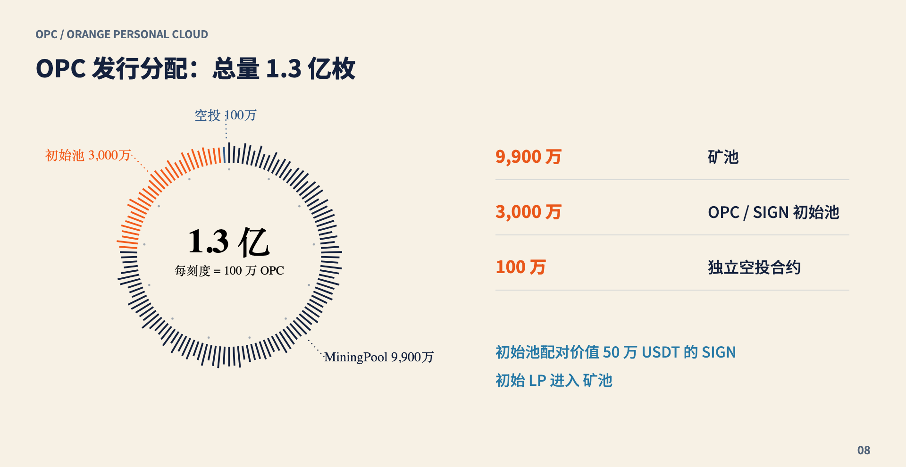

# 09 OPC 发行与分配：明确总量和用途

OPC 代币总量为 130,000,000 枚，分配至矿池、初始 OPC/SIGN 流动性与独立空投合约。三项用途分别对应奖励供给、初始交易流动性和合格新用户空投。总量分配是理解后续机制的起点，读者可以沿每部分数量与用途，进一步了解资产在矿池中的持有、配置和转换。

图08 按实际数量展示 1.3 亿枚 OPC 的分配。矿池为 9,900 万枚，初始流动性为 3,000 万枚，新用户空投为 100 万枚；三项相加与发行总量一致。

| 分配用途 | OPC 数量 | 占总量比例 | 对应安排 |
| --- | ---: | ---: | --- |
| 矿池 | 99,000,000 | 约 76.15% | 进入矿池安排 |
| 初始 OPC/SIGN 流动性 | 30,000,000 | 约 23.08% | 与价值 500,000 USDT 的 SIGN 配对 |
| 独立空投合约 | 1,000,000 | 约 0.77% | 按新用户空投规则分配 |
| 合计 | 130,000,000 | 100% | 发行总量 |

表中比例经过四舍五入，数量是核对分配的依据。初始流动性使用 3,000 万枚 OPC 与价值 50 万 USDT 的 SIGN 配对，形成的初始流动性凭证（LP）进入矿池。初始 LP 表示已经配置的配对资产，其底层 OPC 已包含在总量分配中，统计时按同一份资产核对。

## 代币数量、流动性与奖励库存

OPC 数量、LP 份额和 USDT 计价分别表达不同对象。代币分配回答发行总量被安排到哪里；LP 代表配对流动性中的份额；USDT 计价用于收益型入金及相关收益核算。初始配对中“价值 50 万 USDT 的 SIGN”描述用于配对的 SIGN 价值，后续流动性中的资产数量与价值随实际交易变化。

矿池与流动性存在连续关系。初始 LP 进入矿池，后续收益型入金也按规则形成即时或递延 LP。矿池每日赎回 0.1% 的 LP，将其中 OPC 留池，并用 SIGN 买入 OPC 留池，形成奖励库存。资产从配对流动性转换为 OPC 库存，为奖励发放提供对应来源。

奖励库存与结算规则共同运行。静态奖励按本金 USDT 和当期日率计算，再使用结算期公示的 OPC 换算价确定支付数量；动态部分以本次静态 OPC 数量为基数另设预算。库存提供支付资产，结算记录提供金额、价格与资格依据，使每次发放能够对应到具体参与记录。

## 独立空投的数量边界

独立空投合约安排 100 万枚 OPC，每日分配 1 万枚，以首次达到 200 USDT 资格的参与记录识别合格新用户，每个合格新用户参与一次。当天额度由当日合格人数均分，实际发放上限为合约剩余库存。空投采用独立账目，不计入矿池静态或动态奖励预算。

每天有人符合资格时，按当天人数计算均分数量；无人符合资格时，额度留存于合约。库存用尽后，结束该轮空投。这样的安排把总库存、每日额度与每人资格连在一起，使新用户分配拥有清楚的数量和参与边界。独立空投不计入累计收益 2.5 倍出局的核算。

## 分配服务于不同参与方式

个人云使用者围绕工作购买服务，创作者围绕任务提供交付，矿池参与者依据独立记录核算奖励。OPC 的发行安排为流动性与奖励配置代币，SIGN 则连接服务结算、收益型入金交换与配对资产。不同角色沿各自规则参与，共同构成产品与经济机制的连接。

读者可以先用总量表核对发行，再沿入金、LP、奖励库存和账户结算理解流转。同一资产的分配、持有和转换在账目中连续体现，每次奖励又按发放时记录的 USDT 价值计入累计收益。明确数量和用途，让后续机制能够建立在一致的资产基础上。
