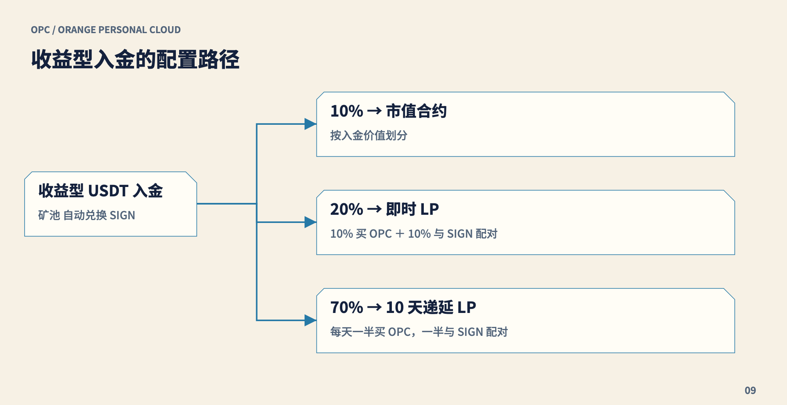
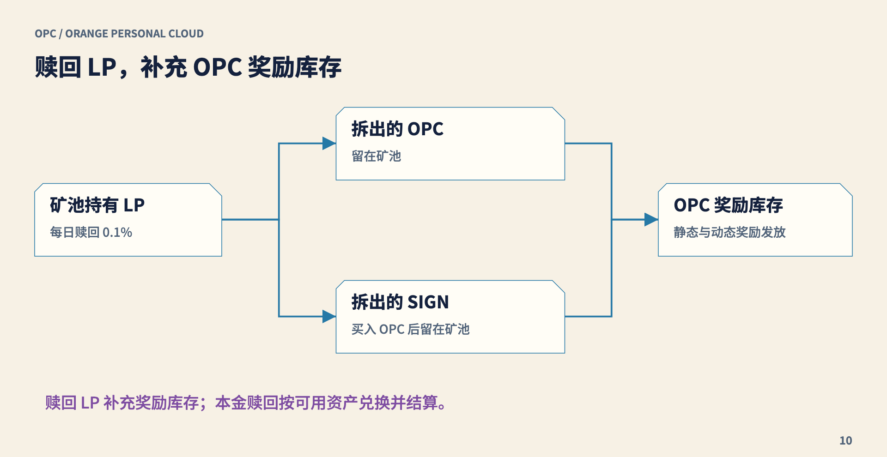

# 10 收益型入金与流动性：跟随每一段资金路径

收益型 USDT 入金进入矿池后，自动换为 SIGN，再按照 10%、20% 与 70% 的比例分别进入市值合约、即时 LP 与十天递延 LP。SIGN 在这条路径中承担中间交换资产，OPC 与 SIGN 共同形成配对流动性。每笔参与按本金 USDT 建立记录，资产配置、奖励核算与出局判断沿该笔记录衔接。

图09 将入金价值拆分为市值合约、即时 LP 和递延 LP。即时部分在买入 OPC 与保留 SIGN 配对之间各占入金价值的 10%；递延部分按十天内的实际安排推进。

## 以 1,000 USDT 观察分流

一笔收益型入金为 1,000 USDT 时，价值 100 USDT 的部分进入市值合约，价值 200 USDT 的部分形成即时 LP，价值 700 USDT 的部分用于十天递延 LP。即时 LP 的 200 USDT 再分为两侧：入金价值的 10%，即 100 USDT 用于买入 OPC；另 10%，即 100 USDT 对应的 SIGN 与其配对。

| 路径 | 占本次入金价值 | 1,000 USDT 算例 | 对应动作 |
| --- | ---: | ---: | --- |
| 市值合约 | 10% | 100 USDT | 进入市值合约 |
| 即时 LP | 20% | 200 USDT | 100 买 OPC，100 对应 SIGN 配对 |
| 十天递延 LP | 70% | 700 USDT | 在十天内分批添加流动性 |
| 合计 | 100% | 1,000 USDT | 与本次入金价值一致 |

这张表按 USDT 价值说明分流。每次买入对应的 OPC 数量和配对 SIGN 数量，依据实际执行时价格形成；参与记录保留本金价值，配置进度则反映资金怎样进入对应资产。用户因此可以同时理解投入基准与执行结果，沿同一笔记录查看后续奖励。

## 十天分批配置递延 LP

70% 的递延部分在十天内分批添加 LP，每日披露实际配置进度。每一天安排的资金，一半用于买入 OPC，另一半以 SIGN 与其配对。十天描述配置周期，每日金额按实际执行安排，不采用每天等额的固定拆分。以 700 USDT 递延部分为例，核对重点是累计完成额和剩余配置额。

每次配置都沿相同配对规则运行。当天实际安排金额明确之后，买入 OPC 与 SIGN 配对各使用其中一半，完成后进入对应 LP。披露每日进度，可以让参与者看到分批执行如何向十天配置目标推进，也让递延中的资金与已经形成的流动性保持清楚关系。

分批配置的记录与参与本金分开表达。本金 USDT 是收益核算与出局判断的基准，LP 是资金配置后的资产形态。参与者查看记录时，可以沿本金、即时配置、递延进度和当前奖励继续核对，而无须把流动性中的价格变化重新当作另一笔入金。

## 每日赎回 LP 形成奖励库存

矿池每日赎回 0.1% 的 LP。赎回得到的 OPC 留在矿池，SIGN 用于买入 OPC 后也留在矿池，两条路径最终形成 OPC 奖励库存。该过程把配对资产转成奖励支付资产，属于现有资产的转换。服务收入承担对应服务成本，矿池则依据自己的库存机制组织奖励发放。

图10 展示 LP 赎回后的两条去向。OPC 直接留池，SIGN 买入 OPC 后留池，结果都是矿池中的 OPC 奖励库存；资产形式的转换与外部业务收入分别记录。

静态奖励使用本金 USDT 作为计价基准，再按当期公示 OPC 换算价支付。动态奖励在静态 OPC 数量之外另设预算，实际分配遵循关系与等级。流动性资产、奖励库存和账户记录通过这些规则衔接，让每笔奖励能够说明从哪里提供支付资产，以及按什么基准计算。

## 资产配置与赎回结算

提前赎回使用矿池可用资产，按流程兑换 USDT 后结算。符合资格的申请按申请顺序处理；可用流动性不足时进入队列，按可执行金额分批完成，并公开待处理状态。资金配置与本金赎回因此都进入可查看的处理过程，参与者能够识别申请状态和已经完成的金额。

服务购买则沿另一条明确路径运行：用户购买额度，按使用扣减，剩余额度按比例原路退款。服务账户与独立矿池本金各自结算，活动应用制作所消耗的服务费用不会重新计入矿池本金。清楚记录资金性质与去向，让产品使用和收益型参与都能按照各自目标进行管理。
