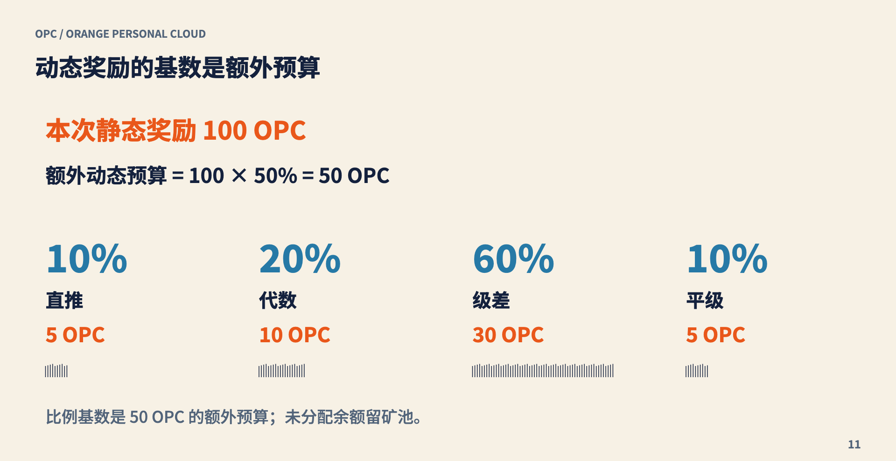

# 11 奖励安排：静态、动态与新用户空投

OPC 的奖励安排包括静态奖励、动态额外预算和独立新用户空投。静态部分按本金 USDT 计价，以 OPC 支付；动态预算按照本次静态奖励的 OPC 数量另行计算；空投由单独的 100 万枚 OPC 合约按日分配。三者各有基数与参与条件，账户依据发放记录核对数量和价值。

## 静态奖励按期公示和结算

静态日率在 0.5%—1% 区间，按结算期公示适用值。日应计 USDT 等于该笔本金 USDT 乘以当期日率，发放 OPC 数量等于应计 USDT 除以当期公示 OPC 换算价。这样的计算把本金、日率与代币支付连在一起，使每次结算都有可以逐项核对的依据。

换算价采用结算期平台公示的 OPC/SIGN 配对折算 USDT 参考价，并记录时间与口径。用户查看奖励时，可以同时看到本期适用日率、对应 USDT 应计价值、使用的 OPC 换算价与最终发放数量。价格发生变化后，新一期按新记录结算，已经记录的收益保持原发放价值。

USDT 本位贯穿收益与出局核算。SIGN 价格上涨时，本金基准与累计收益仍使用 USDT；OPC 在发放后的市场变化，也不追溯重算已经记录的收益。核算围绕每次结算时确定的价值持续累加，让不同结算期的奖励能够放在同一账户基准中比较。

## 动态预算在静态奖励之外计算

动态额外预算等于本次静态奖励 OPC 数量的 50%。假设本次静态奖励为 100 OPC，对应动态预算就是另外的 50 OPC。预算按直推 10%、代数 20%、级差 60%、平级 10% 划分，各类别形成独立可分配额度，依据已生效关系与等级逐层结算。

图11 以 100 OPC 静态奖励为起点，另外形成 50 OPC 动态预算。四类预算分别为 5、10、30 和 5 OPC，合计 50 OPC；每类实际发放合计以该类别预算为上限。

| 动态预算类别 | 占本次动态预算 | 100 OPC 静态奖励对应数额 |
| --- | ---: | ---: |
| 直推 | 10% | 5 OPC |
| 代数 | 20% | 10 OPC |
| 级差 | 60% | 30 OPC |
| 平级 | 10% | 5 OPC |
| 合计 | 100% | 50 OPC |

关系与等级在结算期开始时快照，同期按该快照核对参与条件。同一类别总发放不超过类别预算，未满足资格的余额留在矿池。预算划分与实际发放分别记录，用户因此能够看到某次奖励对应的预算、符合资格的分配和留池金额，保持核算连续。

复投视作新一笔参与，建立新的本金与计价记录，按新记录进入后续结算。原有参与中已经记录的收益保持原记录，不重复计算为新收益。新旧参与分别核对，让本金、奖励和出局阈值对应到具体参与，而不在多次配置之间混合计算。

## 新用户空投独立分配

新用户空投合约配置 1,000,000 OPC，每日分配 10,000 OPC，以首次达到 200 USDT 资格的参与记录识别新用户，每个合格新用户参与一次。当天额度由当日合格人数均分，实际发放上限为合约剩余库存。每日分配完成后，对应资格与发放数量进入空投记录。

无人合格时，当天额度留在合约；合约库存用尽后，该轮空投结束。每日 1 万 OPC 是当日分配额度，均分结果随当日合格人数确定。空投使用独立库存与资格记录，用户可以清楚看到自己的参与资格及最终获得数量。

独立空投不计入累计收益 2.5 倍的出局核算。矿池累计收益包含静态与动态奖励，以每次发放时记录的 USDT 价值累加。三类分配因此既能在个人账户中展示，也保持各自的计算和资格边界。

## 奖励记录连接出局判断

每笔参与记录保留本金 USDT、已结算的静态与动态收益、对应价格及累计价值。累计收益达到本金 2.5 倍时出局；申请提前赎回时，则以已累计收益是否超过本金 50% 判断资格。已支付代币的后续价格变化不回改此前记录，使资格判断使用同一套历史价值。

产品服务与矿池奖励各自运行。购买服务获得额度，创作者完成任务形成服务交付，SIGN 承接底层结算；收益型参与则依照矿池记录分配 OPC。对于活动应用经营者和市场创作者，这种清楚的分工让业务服务有对应费用，也让选择参与矿池的人能够依据完整规则核对奖励。
