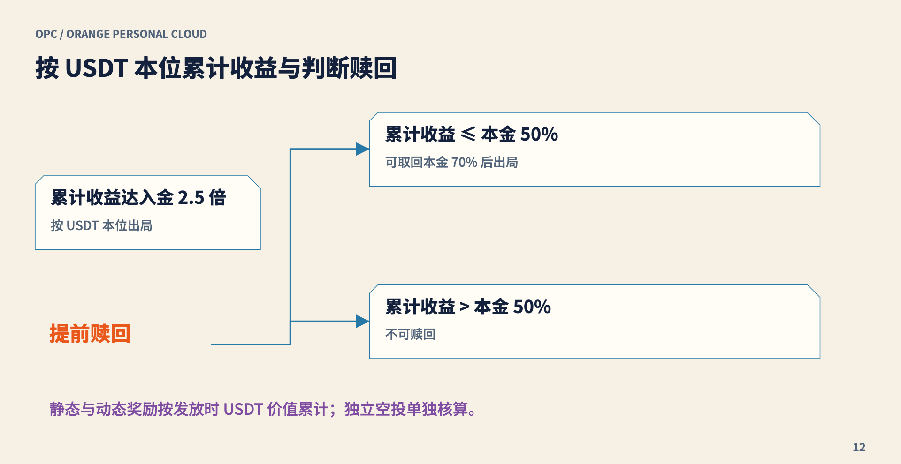

# 12 出局、提前赎回与交易税

收益型机制规定累计收益出局、提前取回本金的条件和代币交易税。累计收益达到入金 2.5 倍出局；累计收益不超过本金 50% 时，可以取回本金 70% 后出局，超过 50% 则不可赎回。买入税为 0，卖出税为 8%—49%，按交易时展示的适用税率执行。参与者可以沿账户记录和交易明细核对这些规则。

图12 区分累计收益达到 2.5 倍的出局，以及提前赎回的 50% 判断线。累计收益恰好等于本金 50% 时，属于可申请提前赎回区间；超过该线则不具备相应赎回资格。

## 按发放记录累计 USDT 收益

累计收益包含静态与动态奖励，按每次发放时记录的 USDT 价值累加，不包含独立新用户空投。以本金 1,000 USDT 为例，累计收益达到 2,500 USDT 时，关闭该笔参与的收益资格。每次奖励的 OPC 数量及其结算价值保留在记录中，帮助用户理解累计值如何形成。

SIGN 或 OPC 价格后来发生变化，已经记录的收益不追溯重算。USDT 本位因此贯穿本金、日应计价值、累计收益与出局阈值。用户持有或交易已支付的 OPC，是发放之后的资产活动；该笔参与的收益判断继续使用发放时已经确定的价值。

复投以新一笔参与建立记录，原参与的累计收益保持原账。用户能够分别看到每笔本金、已结算奖励和对应出局状态。这样的处理将多次参与分开核对，使新资金按照新记录运行，已经取得的收益也有清楚的归属。

## 提前赎回按金额边界处理

累计收益不超过本金 50%，可以取回本金 70% 后关闭该笔参与；累计收益超过本金 50%，不可按该规则赎回。以 1,000 USDT 本金为例，累计收益在 500 USDT 及以下时，可取回的本金为 700 USDT，完成后出局；累计收益超过 500 USDT 时，不符合该条件。

| 1,000 USDT 本金的情形 | 对应结果 |
| --- | --- |
| 累计收益 ≤ 500 USDT | 可按规则取回 700 USDT 本金后出局 |
| 累计收益 > 500 USDT | 不可按该规则赎回本金 |
| 累计收益达到 2,500 USDT | 触发累计收益 2.5 倍出局 |

本金赎回从矿池可用资产按流程兑换 USDT 结算。可用流动性不足时，申请按申请顺序进入处理队列，按可执行金额分批完成，并公开待处理状态。用户能够查看申请处于什么阶段、已经完成多少，以及仍在处理的余额，依据状态安排自己的资金使用。

服务退款使用独立服务账目。未使用的服务额度按比例原路退款，已消耗服务不退款，该动作不改变独立矿池本金。活动应用经营者可以按服务需要管理额度，同时按矿池记录处理参与资格，两类结算各有对应依据。

## 买卖税与税额分配

OPC 买入税为 0，卖出税在 8%—49% 区间。卖出时展示本次适用税率，用户可以在交易明细中查看卖出价值、税额与对应结果。盈利以结算前记录的成本与卖出价值计算，具体卖出页面提供明细，帮助用户理解本次交易。

税收净额按照 50% 分给 V4—V8、20% 进入市值钱包、10% 用于社区奖、20% 进入生态基金的比例分配。各项比例以税收净额为基数，合计 100%。等级相关分配依据当期生效关系与等级记录处理，让税额来源和去向可以分别核对。

| 税额去向 | 占税收净额 |
| --- | ---: |
| V4—V8 | 50% |
| 市值钱包 | 20% |
| 社区奖 | 10% |
| 生态基金 | 20% |
| 合计 | 100% |

跌幅达到 49% 时，停止当期奖励发放，并清零该期未结算奖励。已经支付的收益和用户已持有的代币余额保持原记录。规则作用于当期未结算部分，使停止发放的处理范围与历史已完成结算清楚区分。

## 让每项动作有对应记录

出局处理收益资格，提前赎回处理符合条件的部分本金，卖出处理代币交易与税费，服务退款处理未消费额度。用户根据自己要进行的动作，查看相应账户、资格与处理状态。每一条路径都有明确的计价和记录对象，帮助不同参与方式保持一致。

从入金配置到奖励、赎回和交易，USDT 本位与发放时记录贯穿全程。明确的数值边界、公示的适用价格、按顺序处理的赎回状态和完整税额明细，共同构成参与者核对机制的基础，使产品服务与资产活动能够沿各自规则持续运行。
